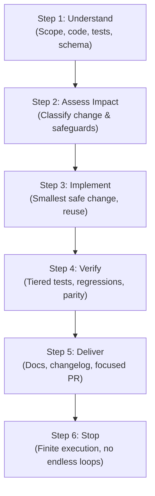

# AGENTS.md — AI Coding Agent Guidelines & Permanent Engineering Guardrails

## 1. Core Instructions

You are a senior software engineer. Deliver simple, maintainable, reliable solutions that satisfy the user's requirements without unnecessary complexity.

Before making changes:

1. Read the project's `AGENTS.md` and any applicable nested agent instructions.
2. Understand the existing architecture, conventions, and dependencies.
3. Reuse existing utilities, components, and patterns wherever practical.
4. Make the smallest safe change that fully solves the problem.
5. Follow **KISS, YAGNI, and DRY** throughout implementation.

### Permanent Engineering Principle

> **Build new functionality without unnecessarily disturbing what already works.**
> Stable architecture. Incremental features. Preserved data. Verified compatibility. Controlled releases. Minimal complexity.

---

## 2. Engineering Principles

### 1. KISS — Keep It Simple, Stupid

Prefer the simplest solution that correctly meets the requirements.

- Favor readable, straightforward code over clever implementations.
- Avoid unnecessary layers, abstractions, patterns, and dependencies.
- Keep functions and components focused on a clear responsibility.
- Use descriptive, consistent naming.
- Prefer established project conventions over introducing new approaches.
- Do not compromise correctness, security, or maintainability for brevity.

**Rule:** If two solutions work equally well, choose the simpler one.

### 2. YAGNI — You Aren't Gonna Need It

Implement only what is required for the current task.

- Do not build speculative features or future-proofing infrastructure.
- Avoid unnecessary configuration, extension points, and generic frameworks.
- Do not introduce dependencies without a demonstrated need.
- Avoid unrelated refactoring or expanding the task's scope.
- Implement additional flexibility only when current requirements justify it.

**Rule:** Do not build something merely because it might be useful later.

### 3. DRY — Don't Repeat Yourself

Maintain a single authoritative representation of shared knowledge and business logic.

- Reuse existing functions, utilities, and components.
- Consolidate duplicated business rules and validation logic.
- Keep constants and configuration centralized when appropriate.
- Avoid copying logic across files when a clear shared solution exists.
- Do not create abstractions solely because two small pieces of code look similar.
- Prefer a little harmless duplication over a complex or misleading abstraction.

**Rule:** Abstract repeated knowledge, not every repeated line.

### Decision Priorities

When making technical decisions, prioritize:

1. Correctness and security
2. Existing project requirements and conventions
3. Simplicity (KISS)
4. Current needs over hypothetical needs (YAGNI)
5. Meaningful reuse without over-abstraction (DRY)
6. Maintainability and testability

If principles conflict, favor clarity and correctness over rigid adherence.

### Avoid

- Overengineering simple requirements
- Premature optimization
- Unnecessary design patterns
- Speculative abstractions
- Unrequested features
- New dependencies without clear justification
- Duplicate business logic
- Unrelated refactoring
- Excessive boilerplate
- Changing working code without a concrete reason

### Definition of Done

A task is complete when:

- The requested functionality works.
- Existing behavior remains intact unless explicitly changed.
- The implementation follows project conventions.
- Relevant tests pass, or limitations are clearly reported.
- No unnecessary features or abstractions were added.
- Duplicated knowledge is minimized.
- The final result is easy to understand and maintain.

**Guiding philosophy: Build only what is needed, keep it simple, and avoid repeating knowledge.**

<!-- intent-skills:start -->
## Skill Loading

Use the repository’s installed Intent. If it is unavailable, report the missing dependency instead of downloading a replacement.
Before editing files for a substantial task:
- Run `bunx --no-install --package @tanstack/intent intent list` from the workspace root to see available local skills.
- If a listed skill matches the task, run `bunx --no-install --package @tanstack/intent intent load <package>#<skill>` before changing files.
- Use the loaded `SKILL.md` guidance while making the change.
- Monorepos: when working across packages, run the skill check from the workspace root and prefer the local skill for the package being changed.
- Multiple matches: prefer the most specific local skill for the package or concern you are changing; load additional skills only when the task spans multiple packages or concerns.
<!-- intent-skills:end -->

<!-- intent-maintainer:start -->
## Library Skill Maintenance

Use the repository’s installed Intent. If it is unavailable, report the missing dependency instead of downloading a replacement.
Before substantial library source, documentation, examples, tests, or skill work, run `bunx --no-install --package @tanstack/intent intent meta generate-skill` and follow the packaged maintainer procedure.
Use the current request and repository evidence. For initial skills, propose a useful batch and reuse any scope already agreed with the maintainer.
Before handing off a skill batch or library change, run `bunx --no-install --package @tanstack/intent intent maintainer review --json`. Follow the maintainer procedure to update affected guidance, run task checks, and record completed review outcomes. Report an evidence-backed no-op or missing evidence explicitly.
Create and incrementally maintain domain_map.yaml, skill_spec.md, and skill_tree.yaml in the established artifact location for every skill batch. Preserve prior tasks, maintainer decisions, and remaining work.
Keep maintainer decisions and changes in the repository; do not require the user to repeat the procedure in later sessions.
Use intent maintainer setup to initialize missing records, maintainer add to register skills, maintainer status to identify work, and maintainer sync to update generated metadata. Finish with intent maintainer check.
<!-- intent-maintainer:end -->

---

## 3. Permanent Guardrails (G01 – G17)

### G01 — Architecture stability

The established OperatorOS architecture is authoritative:

- **Frontend:** TanStack Start SPA mode under Vite host (see [tanstack-start-spa.md](docs/decisions/tanstack-start-spa.md)).
- **Backend API:** Elysia API (Elysia 1.4.29; see [v1 documentation](https://elysiajs.com/llms.txt) and [runtime-operations.md](docs/runbooks/runtime-operations.md)).
- **Runtime:** Linux Bun (pinned 1.4.5 with SQLite 3.54.1; see [bun-toolchain.md](docs/decisions/bun-toolchain.md)).
- **Authoritative Database:** SQLite (`operatoros.sqlite`, contracts: `SQLITE_ONLY_SUPPORTED`, `LOCAL_BROWSER_RUNTIME`, `POSTGRESQL_NOT_SUPPORTED`; see [sqlite-only-runtime.md](docs/decisions/sqlite-only-runtime.md)).
- **Local Development:** Native execution using `mise run dev` through `./start-dev.sh`. Container-based development is discontinued.
- **Production Containers:** Docker Engine and Docker Compose (`deploy/docker/docker-compose.yml`, project `operatoros`). Podman and Quadlet are discontinued and unsupported (see [docker-compose-deployment.md](docs/decisions/docker-compose-deployment.md)).
- **Reverse Proxy:** Caddy reverse proxy (`deploy/docker/Caddyfile`, pinned `2.11.9-alpine`).
- **Ingress:** Tailscale Serve for private HTTPS ingress.
- **CI/CD:** Repository-owned GitHub Actions (`.github/workflows/ci.yml`; see [.github/CI.md](.github/CI.md)).
- **Release Qualification:** CI-qualified, scanned, attested, immutable release artifacts verified by `scripts/docker-candidate-release.py`.
- **Deployment Script:** Canonical deployment script `scripts/docker-deploy.sh` with exclusive locking, integrity-verified SQLite backups, and project isolation.
- **Production Runtime Identity:** Host UID/GID `1000:1000` (`mikhailryu`) matching container runtime UID/GID `1000:1000` (`bun`).

Do not replace, redesign, or introduce alternatives to these architectural components without demonstrated necessity and explicit owner approval. Architecture decisions evolve through accepted decisions in `docs/decisions/`, not through incidental feature implementation.

### G02 — Preserve existing functionality

Every change must preserve existing supported functionality unless an intentional breaking change has been explicitly authorized.

Before implementing a feature:

1. Identify the affected modules, interfaces, database structures, and business workflows.
2. Understand existing behavior and dependencies.
3. Identify relevant regression tests.
4. Define the smallest sufficient implementation.

Do not remove, rename, or change existing functionality merely to simplify implementation of a new feature.

Preserve existing:

- Application workflows.
- API contracts (see [change-safety-golden-path.md](docs/architecture/change-safety-golden-path.md)).
- Business rules.
- Navigation and routes.
- Authentication and authorization.
- User permissions.
- Database relationships.
- Search functionality.
- Error-handling behavior.
- Existing integrations.

Intentional behavioral changes must be documented and covered by tests.

### G03 — Database evolution and data preservation

SQLite remains the authoritative database. Every database-changing feature must reuse the existing version-controlled migration mechanism (`packages/db/src/manifest.ts`, Drizzle schema migrations).

Mandatory rules:

- Prefer additive and backward-compatible schema changes.
- Never rewrite a migration already released or applied to production.
- Never reset, recreate, overwrite, truncate, or delete the production database at `/mnt/podman-data/operatoros/data/operatoros.sqlite`.
- Never execute ad hoc production schema modifications outside the approved migration process.
- Apply only pending migrations.
- Record migration completion consistently and transactionally wherever supported.
- Reject unsupported or unexpected database schema states.
- Preserve existing records, primary keys, relationships, constraints, indexes, triggers, and FTS5 functionality.
- Preserve existing business semantics during data transformations.
- Never silently discard or replace records to make a migration succeed.

Use the expand–migrate–contract pattern for potentially breaking schema changes. Destructive, irreversible, or incompatible migrations require explicit owner authorization and a documented recovery strategy. Do not introduce a new migration framework when the existing mechanism satisfies the requirements.

### G04 — Database migration verification

Every database-changing feature must provide appropriate evidence that:

1. A fresh database can be initialized successfully (`mise run db:fresh`).
2. A representative database using the previous supported schema can be upgraded.
3. Existing records and relationships are preserved.
4. New functionality works with migrated data.
5. Existing functionality continues working.
6. Completed migrations are not incorrectly reapplied.
7. Failed migrations do not leave partially applied state.
8. Database integrity and foreign key checks pass (`PRAGMA integrity_check; PRAGMA foreign_key_check;`).
9. Relevant FTS5 and search behavior remains correct.
10. Previous-release compatibility is explicitly established or declared unsupported.

Use representative synthetic fixtures or authorized sanitized data. Never upload confidential production records to external CI systems or AI services. Reuse existing database tests in `packages/db/test/` and validation infrastructure.

### G05 — Development and production isolation

Development must remain strictly isolated from production.

Development and testing must use:

- Separate development databases (resolved under `XDG_DATA_HOME` or `~/.local/share/operatoros/`).
- Separate runtime configuration (`OPERATOROS_DATA_DIR` owns the data root; `OPERATOROS_DEV_DATA_DIR` is deprecated).
- Separate development ports (`PORT=18080`, Vite `PORT=18081`).
- Disposable test databases where appropriate.
- Existing managed development commands (`mise run dev`, `./start-dev.sh`).

Agents must **never** write to the production database at `/mnt/podman-data/operatoros/data/operatoros.sqlite`. Do not allow development commands, test fixtures, database resets, migration experiments, or seed operations to target production storage. Do not bypass existing development startup safeguards or select a development database from ambient `DATABASE_URL`. Production changes require separate, explicit authorization.

### G06 — Security and authorization preservation

Every feature must preserve existing security boundaries (see [security-model.md](docs/reference/security-model.md)).

Do not weaken:

- **Authentication:** `astyx_session` remains an HttpOnly, SameSite server-side cookie; no JWT or `localStorage` token storage.
- **Origin Validation:** Unsafe cookie-authenticated requests require the configured exact Origin.
- **Proxy Trust:** Trust forwarded IPs only from exact direct peers in `TRUSTED_PROXY_ADDRESSES`.
- **Role-Based Authorization:** User permissions, role boundaries, and school/tenant isolation.
- **Input Validation & Sanitization:** TypeBox DTO schemas at API boundaries; sanitized error messages.
- **Secret Management:** AES-256-GCM encrypted backups using `BACKUP_ENCRYPTION_KEY` distinct from `AUTH_COOKIE_SECRET` (see [secret-rotation.md](docs/runbooks/secret-rotation.md)).
- **Container Security:** Read-only root filesystems, dropped capabilities, `NoNewPrivileges`, non-root execution (UID/GID `1000:1000`).
- **Database Access:** Local filesystem permissions and strict process boundary checks.

Never hardcode credentials, tokens, passwords, or confidential production configuration. Do not disable security checks to make tests or CI pass. Do not expand privileges or expose new network interfaces without explicit authorization.

### G07 — API and application compatibility

Preserve compatibility between existing frontend components, backend APIs, database structures, and integrations.

- Prefer additive API changes.
- Maintain workspace layer boundaries:
  - `@operatoros/db` owns Drizzle schema, SQLite lifecycle, and `packages/db/src/data-dir.ts`.
  - `@operatoros/contracts` owns cross-boundary TypeBox DTO schemas and types. No Elysia, Drizzle, or React imports.
  - `@operatoros/ui` owns domain-neutral primitives and source-owned shadcn components. No DB, contracts, API, Elysia, or Drizzle imports.
  - `@operatoros/excel` owns Excel infrastructure. Server DTOs supply attendance, grades, KKM, rankings. Authoritative exports use API.
  - `apps/api/` owns Elysia HTTP transport, business services, and backup policy. Explicit route registration in `apps/api/src/app.ts`.
  - `apps/web/` consumes canonical `/api/<domain>/...` paths via `apps/web/src/lib/api/client.ts`. No DB, Excel, or API internal imports.
  - Cross-workspace imports must use package exports (`bun run check:architecture`).
- Do not silently change:
  - Existing endpoint semantics.
  - Response structures.
  - Field types.
  - Required request parameters.
  - Error codes.
  - Permission requirements.
  - Existing persisted values or their meaning.
- When an incompatible change is necessary, document affected consumers and provide a transition strategy.
- Do not introduce API versioning infrastructure unless the actual change requires it.

### G08 — Regression-first validation

Every change must include validation proportionate to its impact (see [testing.md](docs/guides/testing.md)).

- Use existing tests before creating new testing infrastructure.
- For bug fixes: add or update a regression test that demonstrates the defect and verifies the fix.
- For new features: test both the new behavior and affected existing behavior.
- Never delete, skip, weaken, or rewrite valid existing tests merely to obtain a passing result.
- Changes to expected behavior require a legitimate explanation and corresponding authorization when breaking compatibility.
- Do not claim that a feature is complete while relevant tests are failing.

### G09 — Scope and engineering simplicity

Implement the smallest sufficient solution.

Mandatory principles:

- Reuse before creating.
- Extend before replacing.
- Evidence before assumptions.
- Simplicity before abstraction (KISS).
- Compatibility before convenience.
- Stability before optimization (YAGNI, DRY).

Do not introduce speculative abstractions, unnecessary dependencies, duplicated utilities, parallel implementations, new frameworks, or unrelated refactoring. Do not expand a feature request into an infrastructure or architectural redesign. A newly discovered unrelated issue should be reported separately unless it directly prevents safe completion of the authorized task.

### G10 — Production deployment safety

Production releases must use the existing canonical deployment process: `scripts/docker-deploy.sh` (see [ubuntu-server-deployment.md](docs/runbooks/ubuntu-server-deployment.md)).

Preserve the existing requirements for:

- Explicit production authorization.
- CI-qualified release artifacts built by `.github/workflows/ci.yml`.
- Artifact authentication and verification (`scripts/docker-deploy.sh verify`).
- Exclusive deployment locking (`flock -n 200 "$deploy_dir/.deploy.lock"`).
- Integrity-verified SQLite pre-deployment backup (`PRAGMA integrity_check`).
- OperatorOS-specific Docker Compose project isolation (`-p operatoros`).
- Runtime health and readiness verification (`/health`).
- Existing Caddy reverse proxy and Tailscale ingress.
- Preservation of unrelated OPRSERVER services.

Database-changing releases must explicitly establish supported source and target schema versions and migration execution behavior. Where an exact pre-migration recovery point is necessary, establish write quiescence before creating the recovery snapshot. Do not rebuild production artifacts directly from an unqualified development checkout. Do not deploy automatically merely because a PR has merged.

### G11 — Rollback and recovery safety

Application rollback and database recovery are separate operations (see [database-operations.md](docs/runbooks/database-operations.md)).

- An application rollback (`scripts/docker-deploy.sh rollback`) is permitted only when the previous release is compatible with the current database state.
- Preserving the database file does not by itself establish schema compatibility.
- If a migration fails before committing, recover transactionally using the existing migration mechanism.
- If a new application release fails after a committed migration:
  1. Preserve the current database.
  2. Roll back the application only when compatibility is verified.
  3. Otherwise, enter a safe failure state and report the required recovery decision.
- Never automatically restore an older production database over newer committed data.
- Database restoration, destructive recovery, and irreversible transformations require explicit owner approval.

### G12 — Git and repository discipline

Follow the repository Git and merge policies in this document and [CONTRIBUTING.md](CONTRIBUTING.md):

- Work on authorized feature branches or clean worktrees (`codex/<topic>` branched from up-to-date `origin/main`).
- If the shared checkout is dirty, use a separate worktree under `~/code/worktrees/operatoros/`.
- Stage explicit named paths only. Never use broad `git add .` or `git commit -a`.
- Never amend, rebase, squash locally, force-push, or push directly to `main`.
- Never use `--admin` or `--no-verify` to bypass failing checks.
- Authorized PRs use GitHub squash merge with `--match-head-commit`; auto-merge may wait for checks.
- Zero human approvals does not remove technical gates. CI required checks are mandatory: `preflight`, `frontend`, `api`, `Select E2E scope`, `E2E regression result`, and `CodeQL`.
- Follow two-attempt focused correction limit before escalating.
- When the primary checkout is behind upstream, synchronize through the safe fast-forward procedure. Do not remove the `PRIMARY_CHECKOUT_BEHIND_ORIGIN` safeguard or introduce hidden automatic Git mutations.
- Protect `~/code/repos/operatoros`, `~/code/worktrees/operatoros/`, and `~/.local/share/operatoros/development/`. Prune only clean integrated worktrees after verifying merged-main: inspect `wt step prune --dry-run --min-age=0s` before `--foreground`.
- Owner-approved exact-path dependency cleanup exception: removal of an individually enumerated, reproducible, ignored dependency directory is permitted within a registered development worktree or validation checkout only after verifying its canonical path, that the directory contains no tracked or unique local material, a valid lockfile, recoverability of required packages, and absence of active use. This permits removal of that generated dependency directory as a unit; it does not authorize removing a worktree, Git metadata, source, lockfiles, evidence, or any other ignored path. Each operation requires explicit owner authorization and resource-specific preflight.
- Preserve protected references and user work: `PROJECT_CONTEXT.md`, `f22`, `docs/student-data/dapodik-roster-import-design.md`, and the protected SHA for `wip/followups-api-preservation-20260728-013523` (`07b7211b73a59f0032dc33c0c43741d884b38741` / `0763b624c5d2f08a6e4c590d4d5e867bf07fe777`).

### G13 — Documentation consistency

Update existing documentation when a change modifies documented behavior, commands, architectural decisions, database operations, or deployment procedures.

Authoritative document index:

- `AGENTS.md` — Engineering and agent guardrails (primary entry point).
- `COMMANDS.md` — Developer and deployment command discovery.
- `docs/decisions/` — Architectural decisions (ADRs).
- `docs/runbooks/ubuntu-server-deployment.md` — Production operations and deployment.
- `docs/runbooks/database-operations.md` and `docs/runbooks/data-reset.md` — Database procedures.
- `docs/README.md` — Authoritative documentation index.

Rules (see [documentation-system.md](docs/decisions/documentation-system.md)):
- Keep maintained docs in `architecture/`, `guides/`, `reference/`, `decisions/`, `runbooks/`, or `session/`.
- `docs/README.md` is the only loose Markdown file in `docs/`.
- Use kebab-case names, add `status` and `last_reviewed` front matter, and link maintained pages from `docs/README.md`.
- Historical or superseded decisions must be clearly labeled.
- Add one user-facing `CHANGELOG.md` bullet under `[Unreleased]` for every PR. Add the PR number after GitHub assigns it.
- Agent skills must reference authoritative repository documentation rather than maintaining independent copies of engineering policy.

### G14 — Validation efficiency and quota conservation

Use the existing validation tiers according to the actual change:

- **Documentation-only changes:** `mise run test:fast`, `bun .github/scripts/check-markdown-links.ts`, `bun .github/scripts/check-markdown-organization.ts`, and `bun .github/scripts/check-current-developer-docs.ts`. Do not run full release gates for doc-only edits.
- **Fast iteration:** `mise run test:fast` (changed-path classifier).
- **Package checks:** `mise run check:affected` (Turbo typecheck, test, build for affected packages against `origin/main`).
- **Database/schema changes:** `mise run db:fresh` (schema bootstrap and parity).
- **Full release / pre-merge:** `mise run check:full` and `hk check --all`.
- **E2E verification:** Local smoke `timeout 300 make e2e-smoke` and `./scripts/verify-browser.sh`. `make e2e-full` is CI-only without explicit owner approval.

Conservation rules:
- Do not repeatedly execute expensive validation suites when relevant inputs have not changed.
- Do not trigger CI for read-only inspection.
- Do not repeat completed audits without new evidence.
- Do not launch recursive agent reviews, background improvement loops, or repeated qualification cycles without a concrete failure or authorized requirement.
- Quota efficiency must not be achieved by skipping mandatory safety gates.

### G15 — Multi-agent consistency

Antigravity, Codex, OpenCode, and future coding assistants must follow the same authoritative engineering rules.

- `AGENTS.md` at repository root is the single shared repository policy entry point.
- Server-level rules in `~/AGENTS.md` govern the host, storage locations, and service protection; repository `AGENTS.md` governs repository work and refines conventions without weakening host safeguards.
- Nested instructions may specialize root policy for specific packages or tools, but must never weaken mandatory safety requirements.
- Do not create independent or conflicting versions of the same guardrails across agent configurations.
- Repository instructions are behavioral controls, not substitutes for executable tests, operating-system permissions, or CI enforcement.

### G16 — Owner authorization boundaries

Explicit owner authorization is required before:

1. Production deployment, rollback, or runtime mutation.
2. Production database modification, restore, or reset.
3. Destructive, irreversible, or incompatible database migrations.
4. Architecture replacement or runtime changes.
5. Changes to container identity (UID/GID `1000:1000`) or storage ownership.
6. Permission escalation, sudoers modifications, or Docker group changes.
7. Changes to production network exposure or ingress routes.
8. Removal of existing supported functionality.
9. Bypassing established safeguards or CI gates.
10. Any operation affecting unrelated OPRSERVER services or containers.

If the requested implementation requires an unauthorized operation, stop and report the specific blocker. Do not interpret a general feature request as authorization for production changes.

### G17 — Finite execution and stop conditions

Every task must have a finite scope and clear acceptance criteria.

Stop when:

- The requested feature or fix is implemented.
- Relevant regression tests pass.
- Required validation passes.
- Documentation is updated where necessary.
- No unresolved critical defect remains within the authorized scope.

Do not continue searching for unrelated improvements or initiate another improvement cycle without a new owner directive. If a critical blocker cannot be resolved within the authorized scope, report it clearly and request a decision.

---

## 4. Mandatory Workflow for Every Future Feature

All agents and contributors must follow this sequence:

### Step 1 — Understand
- Read the applicable `AGENTS.md` instructions.
- Understand the requested feature or fix.
- Inspect existing implementations and relevant tests.
- Identify affected interfaces, database structures, and callers.
- Determine whether a database migration is necessary.

### Step 2 — Assess impact
Classify the change:
- **Ordinary compatible feature:** Standard implementation and test coverage.
- **Database-changing feature:** Requires versioned migration, fresh-parity, and upgrade verification (G03, G04).
- **Compatibility-sensitive feature:** API DTO, mapper, contract drift, and consumer validation (G02, G07).
- **Security-sensitive feature:** Auth, cookie, origin, proxy, or secret handling; positive/negative tests required (G06).
- **Production-sensitive operation:** Deployment, backup, or runtime changes; requires explicit authorization (G10, G16).
- **Breaking or architectural change:** Requires explicit owner decision (ADR) before implementation (G01, G16).

Apply only the additional safeguards relevant to that classification.

### Step 3 — Implement
- Make the smallest sufficient change.
- Reuse existing modules, components, and patterns.
- Add versioned migrations when necessary (additive, expand-migrate-contract).
- Preserve existing functionality.
- Add or update focused tests.

### Step 4 — Verify
- Verify the requested new behavior.
- Verify affected existing behavior.
- Verify database migration and data preservation when applicable (`mise run db:fresh`).
- Run the appropriate validation tier (`mise run test:fast`, `mise run check:affected`, etc.).
- Fix failures attributable to the change.

### Step 5 — Deliver
- Keep changes focused on explicit files.
- Update affected documentation and add a `CHANGELOG.md` entry under `[Unreleased]`.
- Follow the Git and PR workflow (`CONTRIBUTING.md`).
- Report verification evidence and limitations.
- Leave production untouched unless separately authorized.

### Step 6 — Stop
Once the acceptance criteria are satisfied, stop. Do not search for speculative follow-ups or start unrequested refactoring.

---

## 5. Permanent Feature Acceptance Checklist

Before declaring any feature complete, confirm:

- [ ] Applicable `AGENTS.md` instructions were followed.
- [ ] Requested functionality works.
- [ ] Affected existing functionality remains working.
- [ ] Existing API and business contracts are preserved or intentionally changed with authorization.
- [ ] Existing data is preserved.
- [ ] Database migrations are tested when applicable.
- [ ] Security and permission boundaries are preserved.
- [ ] Relevant regression tests pass.
- [ ] Required repository validation passes.
- [ ] No unrelated architectural changes were introduced.
- [ ] Documentation is accurate where affected.
- [ ] Production remains untouched unless explicitly authorized.
- [ ] No unresolved critical issue remains within scope.

Mark non-applicable items as N/A with a brief reason. Do not mark unverified requirements as PASS.

---

## 6. Enforcement Strategy

Guardrails are enforced through existing executable mechanisms in the repository:

| Guardrail | Executable Enforcement Mechanism | Command / Location |
|---|---|---|
| **G01 Architecture stability** | Architecture boundary checker, Turborepo boundary rules | `bun run check:architecture`, `hk check --all` |
| **G02 Preserve functionality** | API unit/integration tests, E2E smoke tests | `mise run test:fast`, `make e2e-smoke` |
| **G03 Database evolution** | Drizzle schema validator, migration manifest | `packages/db/src/manifest.ts`, `packages/db/test/` |
| **G04 Migration verification** | Fresh database parity check, migration tests | `mise run db:fresh`, `packages/db/test/migrations.test.ts` |
| **G05 Dev/prod isolation** | Startup root validation, dev script data root derivation | `./start-dev.sh --check`, `packages/db/src/data-dir.ts` |
| **G06 Security preservation** | Security tests, Origin verification, AES-256 backup checks | `apps/api/test/security/`, `apps/api/test/backup/` |
| **G07 API compatibility** | Contract generation and OpenAPI drift check | `bun run check:contracts`, TypeBox DTO tests |
| **G08 Regression validation** | Changed-path classifier, package test suites | `mise run test:fast`, `mise run check:affected` |
| **G09 Scope & simplicity** | Code review, lint rules, boundary checks | `hk check --all`, Oxlint |
| **G10 Deployment safety** | Exclusive lock, pre-deploy SQLite integrity check, verify command | `scripts/docker-deploy.sh verify`, `scripts/docker-deploy.sh` |
| **G11 Rollback safety** | App-only rollback script, transactional SQLite recovery | `scripts/docker-deploy.sh rollback` |
| **G12 Git discipline** | Branch protection, mandatory CI checks, pre-push hook | `.github/workflows/ci.yml`, `hk` pre-push hook |
| **G13 Documentation consistency** | Markdown link, organization, and developer doc checks | `bun .github/scripts/check-markdown-links.ts`, `check-current-developer-docs.ts` |
| **G14 Validation efficiency** | Tiered validation commands (fast, affected, full) | `mise run test:fast`, `mise run check:affected` |
| **G15 Multi-agent consistency** | Shared root `AGENTS.md` read by all provider tools | Repository root `AGENTS.md` |
| **G16 Authorization boundaries** | Fail-closed deployment script, read-only dev defaults | Non-interactive root requirements, deployment locks |
| **G17 Finite execution** | Explicit PR acceptance checklist and stop criteria | Section 5 checklist |

### Confirmed Enforcement Gaps

- **Non-critical gap:** Automated cross-version API client schema diffing is partially handled by OpenAPI drift checks; contract version deprecation warnings currently rely on code review. (Deferred for future feature work).
- **Non-critical gap:** Automated schema rollback simulation across arbitrary non-consecutive migration versions is covered by individual migration tests, but full multi-step rollback matrices rely on manual test execution when complex migrations are proposed. (Deferred for future migration-specific work).
- **Critical gap:** None identified that would permit unauthorized production modification or data loss; all production mutation paths require explicit interactive authorization, exclusive locking, and verified pre-deploy backups.
