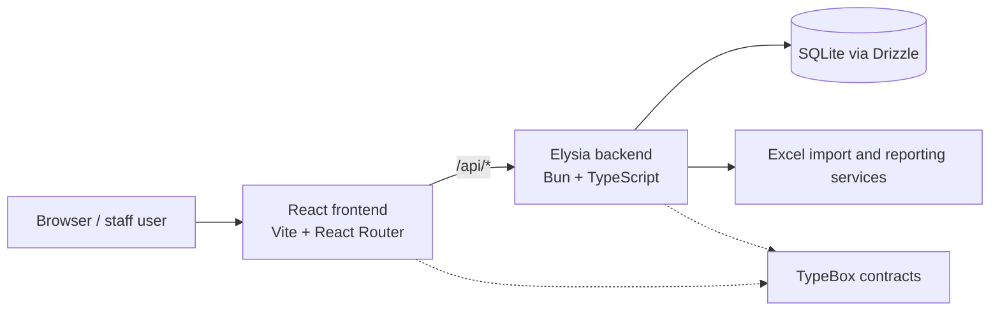
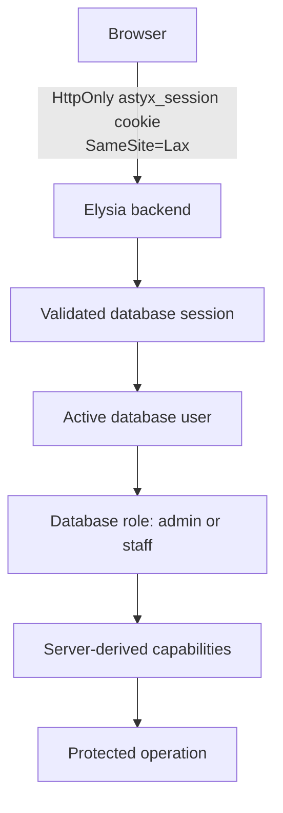
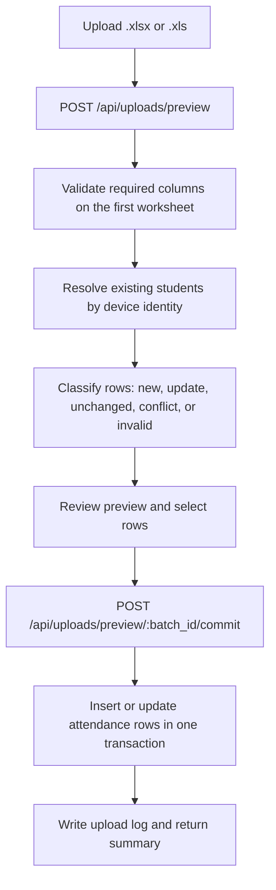

# OperatorOS

OperatorOS is an offline-first school attendance and academic analytics system for a
local installation. The supported runtime is a local Elysia/TypeScript backend
with the React frontend in a browser, backed by SQLite. PostgreSQL and containerized
hosted deployment are not supported.

Current developer and operational guidance is indexed in [docs/README.md](docs/README.md);
[AGENTS.md](AGENTS.md) is the authoritative execution contract.

## What It Does

Implemented:

- Imports attendance workbooks (`.xlsx`, plus legacy `.xls`) through a non-mutating
  preview followed by an explicit commit.
- Resolves attendance-import rows against existing students; an unresolved identifier stays a
  conflict and does not create a student.
- Tracks students, enrollments and class mappings, attendance, HEB calculations,
  absence reasons, upload history, attendance overrides, and correction workflows.
- Generates dashboard, attendance, rekap absensi, tardiness, and term attendance and
  lateness reports.
- Provides Management Analytics for attendance, lateness, grades, and Below-KKM
  counts.
- Supports database-backed KKM thresholds, custom academic term date ranges, and
  Attendance Calendar rules.
- Exposes academic intervention records and intervention-impact analytics through
  canonical APIs; the current browser UI does not expose a create/update workflow from
  Below-KKM alerts.
- Provides descriptive Student Indicator and Student Trend views.
- Exports Excel workbooks and PDF reports. The Management Analytics PDF is an executive
  summary; the Excel workbook carries the detailed sections.
- Provides student-roster import preview/commit and attendance reconciliation workflows.

Not implemented: an At-Risk student classification, risk score, production risk cutoff,
or persisted risk state. The descriptive indicators are not a risk label. See
[Risk Threshold Validation](docs/analytics/RISK_THRESHOLD_VALIDATION.md).

## Architecture



The API is the authority for authentication, authorization, validation, and analytics.
The frontend renders server DTOs and formats chart data; it does not recompute business
metrics. Shared TypeBox contracts own only cross-boundary schemas and types.

## Stack

- Runtime and package manager: Bun 1.4.3, driven through mise.
- API: TypeScript 5.9, Elysia 1.4, Drizzle 0.45, SQLite (`bun:sqlite`), ExcelJS 4.4,
  `@e965/xlsx` 0.20, and pdf-lib 1.17.
- Contracts: TypeBox from the root Bun catalog.
- Frontend: React 19, Vite 6, React Router 7, TanStack Query 5, TanStack Table 8,
  Tailwind CSS 4, Chart.js 4, Framer Motion, and lucide-react.
- Tests: Bun test for the API and packages, Vitest for the web application, and
  Playwright for end-to-end coverage.
- Monorepo: Bun workspaces, Turborepo 2.11.4, and mise task definitions.

## Repository Layout

- [`apps/api/`](apps/api/): Elysia HTTP API, domain services, authentication, security,
  and backup tooling.
- [`apps/web/`](apps/web/): React pages, shared components, API client, query hooks, and
  frontend configuration.
- [`packages/db/`](packages/db/): Drizzle schema, SQLite lifecycle, schema manifest,
  migrations, and canonical data-path resolution.
- [`packages/contracts/`](packages/contracts/): shared TypeBox schemas and types.
- [`packages/ui/`](packages/ui/): domain-neutral UI primitives and source-owned shadcn
  components.
- [`packages/excel/`](packages/excel/): Excel infrastructure and workbook handling.
- [`packages/config/`](packages/config/): shared ESLint and TypeScript configuration.
- [`docs/`](docs/): architecture, security, operations, testing, and product references.
- [`e2e/`](e2e/): Playwright and Bun end-to-end infrastructure.
- [`scripts/`](scripts/): validation, launcher helpers, and the browser smoke test.
- [`start-dev.sh`](start-dev.sh) and [`stop-dev.sh`](stop-dev.sh): managed local
  development launcher and owner-aware stop command.
- [`openapi/operatoros.openapi.json`](openapi/operatoros.openapi.json): version-controlled
  OpenAPI contract.

## Getting Started

### Prerequisites

- A native Linux Bun toolchain, with Bun pinned to 1.4.3 by `mise.toml` and `mise.lock`.
  Do not use Windows executables, `/mnt/c`, or a Windows-mounted checkout.
- mise with at least the `mise.toml` minimum (`2024.1.0`). CI pins mise `2026.10.3`.
- Node 24.19.0 and hk 1.56.1, installed by `mise install`.
- Turborepo 2.11.4, installed as a root dev dependency.
- Agent Browser on the `PATH` only if you want the browser smoke test. Installation
  guidance is in [COMMANDS.md](COMMANDS.md).

### Install the toolchain and dependencies

```bash
mise install
bun install --frozen-lockfile
mise run doctor
```

`mise install` installs the exact Bun, Node, and hk versions from `mise.lock`. Install
workspace dependencies from the repository root only; nested workspace installs are
not authoritative. `mise run doctor` checks the checkout, toolchain, native Linux Bun,
workspace installation, `origin/main`, the development data directory, the canonical
schema head, and development database status without starting services. Run
`git fetch origin main` first if `origin/main` is missing or stale.

### Start the development stack

```bash
mise run dev
```

`mise run dev` delegates to [`./start-dev.sh`](start-dev.sh). The launcher validates Bun,
locked dependencies, and ports; creates or validates the managed development database;
starts Elysia, then Vite; and shows the ready banner only after both health checks pass.
Service logs are stored under `.runtime/operatoros-dev/`. Press `Ctrl+C` to stop both
process groups cleanly.

On a fresh database, open the frontend and create the first administrator on the setup
screen. OperatorOS then closes setup permanently and redirects to normal login. There
are no default credentials.

| Surface | Local development (default) | Supervised host (systemd) |
| --- | --- | --- |
| Frontend | `http://127.0.0.1:5173` | `http://<host>:5173` (interim Vite preview) |
| Backend API | `http://127.0.0.1:8000` | `http://127.0.0.1:8090` (runbook default; loopback) |
| OpenAPI UI | `http://127.0.0.1:8000/openapi` | `http://127.0.0.1:8090/openapi` |

The launcher can use `--auto-port` when the defaults are occupied; the ready banner
reports the selected URLs. Docker/Compose and PostgreSQL are not supported runtimes.
The supervised-host rows come from the review-candidate
[Ubuntu server deployment](docs/deployment/ubuntu-server.md) runbook; its frontend is
an interim Vite preview, not production static hosting, and its API port is an example
that must be verified as free on the target host.

Validate startup prerequisites without starting services:

```bash
./start-dev.sh --check
```

Stop a managed session from the checkout that owns it:

```bash
./stop-dev.sh
```

### Browser smoke test

```bash
./scripts/verify-browser.sh
```

The script does not launch the application. Run it against a live local stack at
`http://127.0.0.1:5173` (or pass another frontend URL) with Agent Browser installed. It
drives the UI and checks same-origin API responses.

### Direct backend and frontend processes (advanced)

The managed launcher is the normal workflow. To run the API directly, bootstrap a
disposable data root first, because the API server never creates or migrates a
database:

```bash
bun packages/db/src/db-cli.ts bootstrap --data-dir /absolute/empty/disposable-data-dir
```

```bash
cd apps/api
OPERATOROS_DATA_DIR=/absolute/empty/disposable-data-dir \
AUTH_COOKIE_SECRET='use-a-local-secret-with-at-least-32-characters' \
ASTRYX_SETUP_TOKEN='use-a-separate-local-setup-token' \
PORT=8000 \
bun run src/server.ts
```

```bash
cd apps/web
BACKEND_PORT=8000 bun run dev
```

First-run setup outside the managed launcher requires `ASTRYX_SETUP_TOKEN`; enter the
same value in the setup form. The API binds `127.0.0.1:8090` by default outside the
managed launcher; set `PORT` to change it. Vite proxies `/api` to `BACKEND_PORT`
(default `8000`), so the direct example sets both to `8000`. Do not point this workflow
at real student data.

## Environment Variables

The managed launcher resolves the persistent development data root from the repository
identity and `XDG_DATA_HOME` (or `~/.local/share`), using `operatoros.sqlite` inside
`operatoros/development/<repository-id>/`. It exports that canonical SQLite URL for every
managed session, warns when inherited `DATABASE_URL` or the deprecated
`OPERATOROS_DEV_DATA_DIR` could drift, and creates one persistent local authentication
secret. Outside managed development, explicit `DATABASE_URL` and `AUTH_COOKIE_SECRET`
values retain their established behavior. The table covers the variables an operator
normally sets; [`apps/api/src/config.ts`](apps/api/src/config.ts) is the parsing authority.

| Variable | Service | Required | Default | Description | Example |
| --- | --- | ---: | --- | --- | --- |
| `OPERATOROS_DATA_DIR` | Backend | No | derived data root | Canonical absolute data-root override. Derives `operatoros.sqlite`, `backups/`, and `logs/`. `OPERATOROS_DEV_DATA_DIR` is a deprecated alias. | `/var/lib/operatoros` |
| `DATABASE_URL` | Backend | No | derived from the data root | SQLite database URL. SQLite is the only supported database; a non-SQLite value fails at database open or configuration validation. Configuration errors can include the configured database string, so never embed credentials in `DATABASE_URL`. When set together with `OPERATOROS_DATA_DIR`, both must resolve to the same database. `DATABASE_PATH` is accepted as an alias. | `sqlite:////var/lib/operatoros/operatoros.sqlite` |
| `ENABLE_DESTRUCTIVE_OPERATIONS` | Backend | No | `false` | Enables guarded API restore and the reset preview/commit routes under `/api/system/data-reset`. Keep false outside a controlled restore or maintenance window. | `true` |
| `AUTH_COOKIE_SECRET` | Backend | Yes | unset | Persistent secret used to derive server-side session token digests. Must contain at least 32 characters; the authentication service rejects shorter values. Store only in protected backend configuration. | *(secret value)* |
| `ASTRYX_SETUP_TOKEN` | Setup API | Yes for first-run outside managed development | unset | High-entropy token authorizing first-run web provisioning. The managed launcher generates one per session. When unset outside managed development, setup authorization is unavailable. | *(secret value)* |
| `COOKIE_SECURE` | Backend | No | `false` | Sets the authentication cookie `Secure` attribute. Use `false` for localhost HTTP and `true` for HTTPS. | `true` |
| `ALLOWED_ORIGINS` | Backend | No | `http://localhost:3000,http://127.0.0.1:3000,http://localhost:5173,http://127.0.0.1:5173` | Comma-separated CORS and unsafe-request Origin allowlist. | `http://localhost:5173,http://127.0.0.1:5173` |
| `TRUSTED_PROXY_ADDRESSES` | Backend | No | unset | Exact direct peer IPs allowed to supply forwarded client IPs. Other peers cannot influence client identity through headers. | `127.0.0.1` |
| `HOST` | Backend | No | `127.0.0.1` | API bind host. | `127.0.0.1` |
| `PORT` | Backend | No | `8090` | API bind port. The managed launcher defaults to `8000`; `--auto-port` can select another free port. | `8000` |
| `BACKUP_ENCRYPTION_KEY` | Backend | Yes for new backups and restore | unset | Canonical Base64 for 32 bytes. Encrypts new backups and must differ from `AUTH_COOKIE_SECRET`. | *(secret value)* |
| `BACKUP_ENCRYPTION_KEY_ID` | Backend | Yes when a backup key is set | unset | Short identifier stored in the authenticated backup envelope. | `local-1` |
| `VITE_API_BASE_URL` | Frontend | No | unset | Build-time API base URL used by the Vite client. If empty, the browser uses same-origin `/api` through the Vite proxy. | `http://localhost:8000` |

Session idle and absolute timeouts default to 6 and 24 hours, and account lockout
defaults to 5 failed attempts for 30 minutes. Those values are not currently exposed as
environment variables.

## Data and Security Boundaries

### Security model

1. Encrypted backup envelopes with integrity checks.
2. Guarded API restore with a safety snapshot and rollback.
3. Database-backed user identity and server-side sessions.
4. Role- and capability-based backend authorization.
5. Authentication, authorization-denial, restore, and destructive-reset audit logging.



Only the backend grants access. Frontend identity and role state are navigation
conveniences. Client fields such as `request.role`, `reviewed_by`, `entered_by`, and
`uploaded_by` are untrusted metadata, not authorization evidence.

The `astyx_session` cookie is HttpOnly, uses `Path=/` and `SameSite=Lax`, and adds
`Secure` when `COOKIE_SECURE=true`. Setup authorization uses `SameSite=Strict`. There is
no JWT, localStorage authentication, remember-me function, or frontend session-token
access. See [Identity and Authentication](docs/security/identity-authentication.md) and
[Security Hardening](docs/security/SECURITY_HARDENING.md).

### Database and migrations

- The current application schema head is S4.8 (`20261002_s48`). A fresh TypeScript
  bootstrap installs the approved S4.7 base from `packages/db/src/s47-schema.sql` and
  applies the S4.8 extension from `packages/db/src/s48-migration.sql`. S4.2
  (`20260724_s42`) is the historical baseline and rollback target, not the
  fresh-bootstrap target.
- The managed launcher and
  `bun run db:bootstrap -- --data-dir <absolute-directory>` create fresh databases. The API server
  opens an existing database with `create: false`, validates it, and never creates or
  silently migrates it.
- Existing outdated databases are rejected and require the controlled migration path in
  [Database Operations](docs/operations/DATABASE_OPERATIONS.md). Ordinary startup does
  not upgrade a database.
- The SQLite data layer enables foreign keys and runs integrity and schema validation at
  open. Drizzle is the application persistence layer.
- The protected operational database remains S4.3 (`20260725_s43`) until a separately
  authorized migration. It is never a development, test, fixture, or E2E target.
- PostgreSQL evaluation artifacts remain historical migration evidence only.

### Backup and restore

- Administrators use the Backup Management page (`/settings/backups`) or the
  `/api/admin/backups` API. Operator scripts are `scripts/backup.sh` and
  `scripts/restore.sh`; the underlying CLI is `apps/api/src/backup-cli.ts`.
- New application backups use an AES-256-GCM envelope keyed by
  `BACKUP_ENCRYPTION_KEY` and `BACKUP_ENCRYPTION_KEY_ID`. The live SQLite database
  remains unencrypted. Legacy plaintext backups require explicit operator opt-in.
- Authenticated API restore requires `ENABLE_DESTRUCTIVE_OPERATIONS=true`, an active
  administrator session, re-entry of the current password, an identity-compatible
  backup, exact filename and `RESTORE_DATABASE` phrase confirmation, the safety
  acknowledgements, checksum/integrity/schema validation, and a pre-restore safety
  snapshot. A failed replacement restores the prior active database; the safety snapshot
  remains as a recovery backup.
- The API preflight validates `users`/`sessions` column compatibility but does not
  verify that the backup contains an active administrator. Confirm an active
  administrator exists in the backup before restoring.
- API restore and reset use process-local operation locks. Restore is not safe with
  multiple API processes; there is no approved cross-process restore lock.
- A successful API restore revokes every restored session and requires all operators to
  sign in again.
- The CLI restore path creates a pre-restore safety snapshot when an active database
  exists and writes restore audit lines, but it does not verify the backup manifest,
  database integrity, schema, or an active administrator, does not perform
  post-replacement checks, and does not revoke sessions. Use it only with all writers
  stopped and an approved recovery procedure.
- Retention keeps the newest 10 complete backup generations. The canonical retention,
  eviction, and restore-audit rules, including current audit gaps, are in
  [Backup and Restore Security](docs/security/backup-restore.md); this README does not
  duplicate those procedures.

See [Backup and Restore Security](docs/security/backup-restore.md),
[Database Operations](docs/operations/DATABASE_OPERATIONS.md), and
[Data Reset](docs/operations/DATA_RESET.md).

### Security and data handling

- OperatorOS uses database-backed users, revocable server-side sessions, an HttpOnly
  cookie, and Argon2id password hashes.
- Backend roles are `admin` and `staff`. Capabilities are derived from the role on the
  server; client-provided roles never authorize a request.
- `/api/system/data-reset` is disabled by default. When enabled, it requires an
  authenticated administrator, the `destructive_data_reset` capability, an exact
  confirmation phrase, and a successful encrypted backup before deletion. No reset
  deletes the database, users, sessions, schema metadata, or backup files.
- Treat imported spreadsheets, SQLite databases, browser artifacts, backups, and
  generated Excel or PDF outputs as sensitive operational data.
- Never commit backup paths, checksums, rows, names, secrets, or personal data.

Implemented security does not include MFA, SSO, OAuth, LDAP, password-reset email,
cloud identity, SQLCipher or live-database encryption, distributed restore locking, or a
general user-management interface. Account provisioning is limited to first-run setup
plus a local operator recovery CLI; see
[User Administration](docs/security/user-administration.md).

## Management Analytics and Academic Config

- Management Analytics is available at `/analytics`.
- The `/analytics` overview uses `GET /api/analytics/management-overview`; filtered
  management exports use the `management-summary` endpoints below.
- Filtered management reports can be downloaded from:
  - `GET /api/analytics/management-summary/export/pdf`
  - `GET /api/analytics/management-summary/export/excel`
- KKM thresholds and term date ranges are configured in `/academic-management` under
  `KKM & Term Settings`.
- Academic config APIs are canonical under `/api/academic-config/...`.
- Academic intervention records and intervention-impact analytics are exposed through
  canonical APIs, including `/api/academic-interventions/...` and
  `/api/analytics/intervention-impact`; the current browser UI does not expose a
  create/update workflow from Below-KKM alerts.
- If no custom KKM threshold applies, analytics preserves the legacy fallback threshold
  `85`.
- If no custom term range exists, analytics preserves the default Term 1-4 date mapping.

## Excel Import Workflow



- The import expects the first worksheet to contain the required attendance columns:
  `No. ID`, `Nama`, `Tanggal`, `Scan Masuk`, `Scan Pulang`, `Terlambat`, `Lembur`,
  `Pengecualian`, and `week`.
- The preview endpoint accepts `.xlsx` and legacy `.xls`. Student roster imports accept
  `.xlsx` only.
- A sample template is available at `GET /api/uploads/sample-template`.
- An unresolved student identifier is a conflict; the attendance import does not create
  students.

## Validation and Testing

`mise run check:affected` runs Turbo `typecheck`, `test`, and `build` for packages
affected since `origin/main`; run `git fetch origin main` first when the remote-tracking
ref is stale or missing. `mise run test:fast` is the changed-path-aware iterative tier.
`mise run check:full` delegates to `make test-release`, the complete release-sensitive
authority. See [COMMANDS.md](COMMANDS.md) for the full command index.

```bash
# Root quality authority: lint, contracts, architecture, typecheck, and tests
mise run check

# Bun suites and repository script tests
mise run test

# Production web build
mise run build

# Specialized checks and data-safe validation
mise run check:affected
mise run test:fast
mise run check:full
mise run db:fresh
```

OpenAPI contracts are generated and drift-checked with the frontend package scripts:

```bash
bun --filter @operatoros/web api:check
bun --filter @operatoros/web api:generate
```

The standardized E2E workflow uses isolated synthetic data and runtime-selected ports;
[`e2e/README.md`](e2e/README.md) is the authoritative guide.

- E2E infrastructure validation: `make e2e-validate`
- Local blocking smoke: `timeout 300 make e2e-smoke`
- Do not run `make e2e-full` locally without explicit owner approval; it is guarded for
  GitHub Actions.
- Backend tests: `bun --filter @operatoros/api test`
- Frontend build: `bun --filter @operatoros/web build`
- Security tests: `bun run test:security`
- Dependency audit: `bun run security:audit`
- Browser smoke: `./scripts/verify-browser.sh`
- Markdown links: `bun .github/scripts/check-markdown-links.ts`
- Current developer docs: `bun .github/scripts/check-current-developer-docs.ts`

See [Contributing](CONTRIBUTING.md), [test strategy](docs/testing/TEST_STRATEGY.md),
[frontend architecture](docs/architecture/FRONTEND_ARCHITECTURE.md), and
[database operations](docs/operations/DATABASE_OPERATIONS.md).

## Troubleshooting

- If the Vite dev server fails, verify workspace dependencies exist. Run
  `bun install --frozen-lockfile` from the repository root if needed.
- If uploads fail, confirm the workbook is `.xlsx` or `.xls` and that the required
  columns exist on the first sheet.
- If startup reports that `DATABASE_URL` conflicts with `OPERATOROS_DATA_DIR`, unset the
  inherited `DATABASE_URL` or point it at the resolved canonical database.
- The canonical checkout is on the Linux filesystem. Connect from Windows through
  SSH/Tailscale; do not use `/mnt/c` or a Windows-mounted checkout.

## Contribution Workflow

1. Read the relevant application, package, and docs files first.
2. Make the smallest safe change.
3. Update or add tests when behavior changes.
4. Run the most relevant verification command.
5. For user-visible frontend changes, run the browser smoke test when Agent Browser is
   available.
6. Document data migrations or operational caveats in the pull request.
7. Stage named paths only. Do not commit secrets, backups, or real student data.

## Historical Context

- The **`v0.9.0-platform-foundation`** inventory, security review, and release notes
  remain the historical Phase 9 baseline.
- The experimental Tauri desktop shell and its Phase 9.6/11 acceptance gates were removed
  on 2026-08-20. The retired Python/FastAPI backend remains only in Git history and
  migration evidence.
- The protected operational database remains S4.3 until a separately authorized
  migration. A restored S4.2 database pairs with the documented rollback application.
- The [historical WSL2 and DevOps guide](docs/WSL2_DEVOPS.md) is retained for migration
  reference, not current onboarding.

## Further Reading

- [Documentation index](docs/README.md)
- [Commands](COMMANDS.md)
- [Contributing](CONTRIBUTING.md)
- [Conventions](CONVENTIONS.md)
- [Frontend guide](apps/web/README.md)
- [Frontend architecture](docs/architecture/FRONTEND_ARCHITECTURE.md)
- [Database schema architecture](docs/architecture/DATABASE_SCHEMA_ARCHITECTURE.md)
- [Database operations](docs/operations/DATABASE_OPERATIONS.md)
- [Data reset](docs/operations/DATA_RESET.md)
- [Test strategy](docs/testing/TEST_STRATEGY.md)
- [E2E guide](e2e/README.md)
- [Identity and authentication](docs/security/identity-authentication.md)
- [Security hardening](docs/security/SECURITY_HARDENING.md)
- [Backup and restore security](docs/security/backup-restore.md)
- [User administration status](docs/security/user-administration.md)
- [Utility scripts](docs/UTILITY_SCRIPTS.md)
- [Agent instructions](AGENTS.md)
