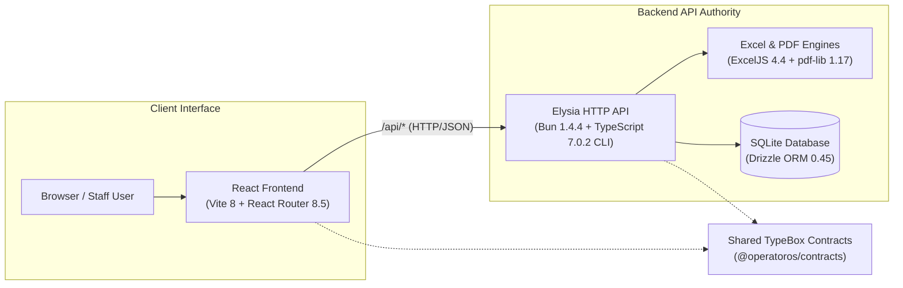
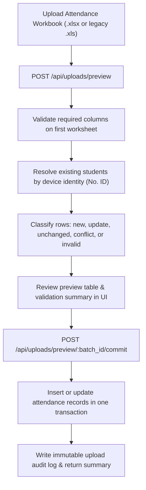
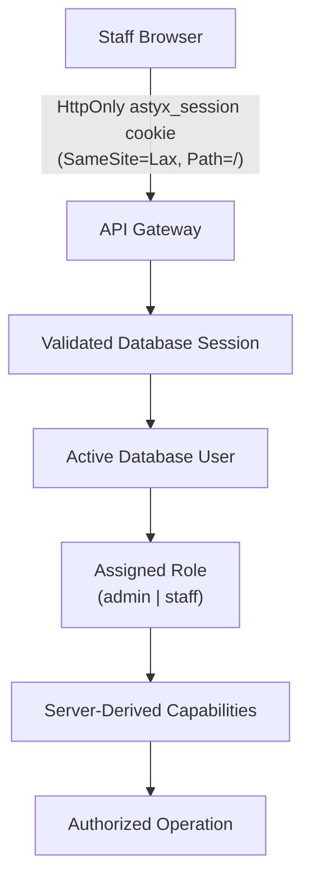

# OperatorOS

> Offline-first school attendance and academic analytics system engineered for local, self-contained school infrastructure.

[](https://github.com/daoistmadness/operatoros/actions/workflows/ci.yml)

---

OperatorOS delivers school attendance processing, automated Hari Efektif Belajar (HEB) calculations, academic performance tracking against Kriteria Ketuntasan Minimal (KKM), and administrative analytics directly on local hardware without depending on external cloud services or persistent internet connectivity.

The supported runtime is a local Elysia/TypeScript backend paired with a React frontend accessed via a local browser, backed by SQLite (`bun:sqlite` via Drizzle ORM). PostgreSQL and containerized hosted deployments (Docker/Podman/Quadlet) are unsupported. An optional rootless Podman workflow is available for local development only.

Current developer and operational guidance is indexed in [docs/README.md](docs/README.md); [AGENTS.md](AGENTS.md) is the authoritative execution contract.

---

## Table of Contents

- [Overview & Architecture](#overview--architecture)
- [Capability & Feature Matrix](#capability--feature-matrix)
- [Core Workflows](#core-workflows)
  - [Attendance Import & Ingestion Pipeline](#attendance-import--ingestion-pipeline)
  - [Management Analytics & Academic Configuration](#management-analytics--academic-configuration)
- [Technology Stack](#technology-stack)
- [Repository Layout](#repository-layout)
- [Getting Started](#getting-started)
- [Environment Configuration](#environment-configuration)
- [Data & Security Boundaries](#data--security-boundaries)
- [Continuous Integration & Quality Safeguards](#continuous-integration--quality-safeguards)
- [Troubleshooting & Contribution](#troubleshooting--contribution)
- [Historical Context](#historical-context)
- [Documentation Navigation](#documentation-navigation)

---

## Overview & Architecture

OperatorOS follows a strict local-first architecture where the backend API remains the sole authority for business rules, identity, and analytics computations. The browser serves strictly as a rendering and input interface.



### Architectural Principles

- **Server-Owned Computation**: The API server is the sole authority for authentication, role authorization, attendance processing, HEB derivation, and academic metrics. The frontend renders server DTOs and formats charts via Chart.js; it never recomputes business metrics or generates authoritative reports.
- **Contract Boundary Integrity**: Monorepo packages enforce strict dependency boundaries via automated architectural tests (`bun run check:architecture`). Shared TypeBox schemas in `packages/contracts/` define cross-boundary DTOs without leaking database or framework internals.
- **Transactional Ingestion**: Attendance data enters through non-mutating preview endpoints (`/api/uploads/preview`) before being confirmed in an explicit transactional commit. Unresolved student identifiers are flagged as conflicts and never create unverified student records.

---

## Capability & Feature Matrix

The table below delineates verified system capabilities, bounded partial features, and explicitly excluded/planned capabilities.

| Capability Area | Status | Contract & Scope |
| --- | :---: | --- |
| **Attendance Ingestion** | **Implemented** | Non-mutating preview (`POST /api/uploads/preview`) and transactional commit (`POST /api/uploads/preview/:batch_id/commit`). Accepts `.xlsx` and legacy `.xls`. Validates required columns (`No. ID`, `Nama`, `Tanggal`, `Scan Masuk`, `Scan Pulang`, `Terlambat`, `Lembur`, `Pengecualian`, `week`). |
| **Student Resolution Safeguard** | **Implemented** | Matches attendance rows against enrolled students by machine device identity (`No. ID`). Unresolved identifiers become conflicts; attendance import never creates new student records. |
| **Academic Calendar & HEB Engine** | **Implemented** | Automated Hari Efektif Belajar (HEB) calculations, Attendance Calendar rules (expected/not-expected dates, cutoffs per jenjang), tardiness tracking, and term reports. |
| **Management Analytics & KKM** | **Implemented** | Overview dashboard (`/analytics`), attendance/tardiness breakdowns, grade distribution, and Below-KKM alert generation with customizable term date ranges and KKM thresholds (legacy fallback `85.0`). |
| **Academic Interventions (API)** | **Implemented** | Canonical API support for intervention tracking and intervention-impact analytics (`/api/academic-interventions/...`, `/api/analytics/intervention-impact`). *(Note: current UI does not expose a create/update workflow from Below-KKM alerts).* |
| **Report Generation** | **Implemented** | Server-generated executive PDF summaries and comprehensive multi-sheet Excel `.xlsx` workbooks. The browser never generates authoritative files locally. |
| **Student Descriptive Views** | **Implemented** | Descriptive Student Indicator and Student Trend views. |
| **Student Roster Import** | **Implemented** | Roster `.xlsx` import preview/commit and attendance reconciliation workflows. |
| **Security & Authentication** | **Implemented** | HttpOnly `astyx_session` cookies (SameSite=Lax), server-side revocable sessions, Argon2id password hashing, and role-based backend authorization (`admin` and `staff`) with server-derived capabilities. |
| **Backup Integrity** | **Implemented** | AES-256-GCM encrypted backup envelopes (`BACKUP_ENCRYPTION_KEY`), SHA-256 checksums, and retention of the newest 10 complete generations. |
| **Guarded Database Restore** | **Implemented** | Admin-authenticated API restore with mandatory password re-entry, identity-compatible backup validation, exact phrase confirmation, pre-restore safety snapshot, and automatic rollback on failure. Revokes all active sessions upon success. |
| **Guarded Data Reset** | **Implemented** | Guarded reset routes (`/api/system/data-reset`) disabled by default (`ENABLE_DESTRUCTIVE_OPERATIONS=true`). Requires admin role, `destructive_data_reset` capability, exact phrase confirmation, and mandatory encrypted pre-reset backup. Never deletes database files, users, sessions, or backups. |
| **User Administration** | **Partial** | Account provisioning is strictly limited to first-run setup plus a local operator CLI (`apps/api/src/user-recovery-cli.ts`). No web-based user management interface exists. |
| **Restore Concurrency** | **Partial** | The runtime does not enforce a worker count, so run one API process per data root. On Linux, the canonical API and CLI share a nonblocking data-root `flock`; CLI restore refuses while the API is running. Other platforms and tools that ignore the lock still require manual writer exclusion. |
| **CLI Restore Utility** | **Partial** | Encrypted CLI restore verifies artifact identity and authentication, SQLite integrity and schema, foreign keys, and an eligible administrator credential; it revokes restored sessions and uses a safety snapshot for rollback when an active database exists. Run it with all API writers stopped; CLI audit writes are best-effort. |
| **Student Risk Classification** | **Not Implemented** | No automated At-Risk student score, classification, cutoff, or persisted risk state exists. Descriptive indicators are strictly informational and do not constitute risk labels (see [Risk Threshold Validation](docs/reference/risk-threshold-validation.md)). |
| **Enterprise / Cloud Auth** | **Not Implemented** | No MFA, SSO, OAuth, LDAP, password-reset emails, or cloud identity integrations. |
| **Database At-Rest Encryption** | **Not Implemented** | Live SQLite database file is unencrypted; encryption applies solely to backup envelopes via `BACKUP_ENCRYPTION_KEY`. |
| **Distributed / Cloud Hosting** | **Not Implemented** | PostgreSQL and containerized hosted deployments (Docker/Podman/Quadlet) are unsupported; optional local Podman development does not change this runtime contract. |

---

## Core Workflows

### Attendance Import & Ingestion Pipeline



- **Supported Formats**: The preview endpoint accepts modern `.xlsx` workbooks and legacy `.xls` files. Student roster imports accept `.xlsx` only.
- **Required Columns**: The first worksheet must provide: `No. ID`, `Nama`, `Tanggal`, `Scan Masuk`, `Scan Pulang`, `Terlambat`, `Lembur`, `Pengecualian`, and `week`.
- **Sample Template**: Downloadable via `GET /api/uploads/sample-template`.
- **Conflict Prevention**: Unresolved student identifiers remain in conflict state; attendance import never creates student entities implicitly.

### Management Analytics & Academic Configuration

- **Overview Dashboard**: Accessible at `/analytics` powered by `GET /api/analytics/management-overview`.
- **Export Endpoints**:
  - Executive PDF summary: `GET /api/analytics/management-summary/export/pdf`
  - Comprehensive Excel report: `GET /api/analytics/management-summary/export/excel`
- **Academic Configuration**: Configured under `/academic-management` (`KKM & Term Settings`) and backed by `/api/academic-config/...`.
- **Fallback Metrics**: Analytics preserves the legacy fallback KKM threshold of `85.0` if no custom rule applies, and uses standard Term 1–4 date mappings when custom terms are unset.
- **Interventions**: Canonical APIs under `/api/academic-interventions/...` and `/api/analytics/intervention-impact` record academic interventions and evaluate impact.

---

## Technology Stack

| Layer | Technologies & Dependencies | Version Authority |
| --- | --- | --- |
| **Runtime & Toolchain** | Bun, Node.js, hk, Turborepo | Bun `1.4.4`, Node `24.19.0`, hk `2.8.1`, Turbo `2.11.4` (pinned in `mise.toml` / `mise.lock`) |
| **Backend API** | Elysia, TypeScript, Drizzle ORM, SQLite | TypeScript `7.0.2` CLI; `5.9.3` for compiler-API compatibility, Elysia `1.4`, Drizzle `0.45`, `bun:sqlite` |
| **Spreadsheet & PDF Engines** | ExcelJS, @e965/xlsx, pdf-lib | ExcelJS `4.4`, `@e965/xlsx` `0.20`, pdf-lib `1.17` |
| **Type Contracts** | TypeBox | `@sinclair/typebox` (monorepo root catalog) |
| **Frontend Web Client** | React, Vite, React Router, TanStack Query, TanStack Table, Tailwind CSS, Chart.js, Framer Motion, lucide-react | React `19.2.7`, Vite `8.3.4`, React Router `8.5.0`, TanStack Query `5`, TanStack Table `9.3.1`, Tailwind CSS `4`, Chart.js `4` |
| **Testing & Quality** | Bun test, Vitest, Playwright | Bun-native test runner, Vitest (web unit), Playwright `1.61.1` (E2E) |

---

## Repository Layout

- [`apps/api/`](apps/api/): Elysia HTTP API, domain services, authentication, security, and backup tooling.
- [`apps/web/`](apps/web/): React pages, shared components, API client, query hooks, and frontend configuration.
- [`packages/db/`](packages/db/): Drizzle schema, SQLite lifecycle, schema manifest, migrations, and canonical data-path resolution.
- [`packages/contracts/`](packages/contracts/): Shared TypeBox schemas and types.
- [`packages/ui/`](packages/ui/): Domain-neutral UI primitives and source-owned shadcn components.
- [`packages/excel/`](packages/excel/): Excel infrastructure and workbook handling.
- [`packages/config/`](packages/config/): Shared ESLint and TypeScript configurations.
- [`docs/`](docs/): Canonical architecture, security, operations, testing, and product references.
- [`e2e/`](e2e/): Playwright and Bun end-to-end infrastructure and synthetic suites.
- [`scripts/`](scripts/): Validation, launcher helpers, and browser smoke test.
- [`start-dev.sh`](start-dev.sh) and [`stop-dev.sh`](stop-dev.sh): Managed local development launcher and owner-aware stop command.
- [`openapi/operatoros.openapi.json`](openapi/operatoros.openapi.json): Version-controlled OpenAPI specification.

---

## Getting Started

### Prerequisites

- **Native Linux Bun Toolchain**: Bun `1.4.4` installed natively on Linux.
  > [!WARNING]
  > Do not use Windows binaries, `/mnt/c`, or Windows-mounted checkouts.
- **mise-en-place**: Version `2024.1.0` or higher (CI uses `2026.10.3`).
- **Installed via mise**: Node.js `24.19.0` and hk `2.8.1` (managed automatically by `mise install`).
- **Browser Smoke Test (Optional)**: Agent Browser installed on the system `PATH` if executing UI smoke verification. Guidance is documented in [COMMANDS.md](COMMANDS.md).

### 1. Install Toolchain and Dependencies

```bash
mise install
bun install --frozen-lockfile
mise run doctor
```

- `mise install`: Installs exact runtime versions from `mise.lock`.
- `bun install --frozen-lockfile`: Installs all monorepo workspace dependencies from the repository root. Nested workspace installs are forbidden.
- `mise run doctor`: Validates checkout hygiene, toolchain versions, native Linux Bun, workspace packages, `origin/main` alignment, development data directory, schema head, and development database state without launching services. (Run `git fetch origin main` first if `origin/main` is stale or missing).

### 2. Start the Development Stack

```bash
mise run dev
```

`mise run dev` delegates to [`./start-dev.sh`](start-dev.sh). The launcher:
1. Validates Bun version, dependency locks, and required ports (`8000` API, `5173` Web).
2. Initializes or validates the managed development database in the canonical data root.
3. Launches the Elysia backend, then the Vite frontend.
4. Displays the ready banner once both health check endpoints respond successfully. Logs are persisted to `.runtime/operatoros-dev/`.

| Surface | URL | Description |
| --- | --- | --- |
| **Frontend UI** | `http://127.0.0.1:5173` | Local React application |
| **Backend API** | `http://127.0.0.1:8000` | Elysia HTTP API |
| **OpenAPI Docs** | `http://127.0.0.1:8000/openapi` | Interactive Swagger / OpenAPI documentation |

> [!NOTE]
> On a fresh database, open `http://127.0.0.1:5173` to initialize the first administrator account. The setup form permanently closes upon creation. There are no default credentials.

### Optional: Rootless Podman Development

On Linux, run the same managed development launcher in a container with
rootless Podman, Git, and `sha256sum`. This alternative uses its pinned Bun
image instead of the host Bun/mise toolchain.

```bash
./scripts/podman-dev.sh
```

Open `http://127.0.0.1:5174`. The API stays private inside the container, and
the frontend port is bound to host loopback. Press `Ctrl+C` to stop. Development
data persists in the `operatoros-podman-dev-data` Podman volume and is isolated
from the native launcher. Set `OPERATOROS_PODMAN_PORT` to change the host port
(1024–65535).
This path uses synthetic local development data only; it does not support
production or hosted Podman deployments.

### Diagnostic & Operational Commands

- **Preflight check without starting**:
  ```bash
  ./start-dev.sh --check
  ```
- **Clean shutdown**:
  Press `Ctrl+C` in the running launcher terminal, or run:
  ```bash
  ./stop-dev.sh
  ```
- **Browser UI smoke test** (runs against a live stack):
  ```bash
  ./scripts/verify-browser.sh
  ```

### Advanced: Direct Backend and Frontend Execution

For isolated testing without `start-dev.sh`, bootstrap a disposable data directory first (the API server never creates or auto-migrates databases):

```bash
# 1. Bootstrap a disposable SQLite database
bun packages/db/src/db-cli.ts bootstrap --data-dir /tmp/disposable-operatoros-data

# 2. Launch Elysia API directly
cd apps/api
OPERATOROS_DATA_DIR=/tmp/disposable-operatoros-data \
AUTH_COOKIE_SECRET='local-dev-secret-must-be-at-least-32-chars-long' \
PORT=8000 \
bun run src/server.ts
```

```bash
# 3. Launch Vite Frontend directly (proxies /api to BACKEND_PORT)
cd apps/web
BACKEND_PORT=8000 bun run dev
```

---

## Environment Configuration

The managed launcher automatically sets the development data root derived from repository identity and `XDG_DATA_HOME` (`~/.local/share/operatoros/development/<repo-id>/operatoros.sqlite`). For standalone execution, configuration parameters are parsed by [`apps/api/src/config.ts`](apps/api/src/config.ts).

| Variable | Target | Required | Default | Purpose & Constraints | Example |
| --- | --- | :---: | --- | --- | --- |
| `OPERATOROS_DATA_DIR` | Backend | No | Derived data root | Absolute directory path for application storage. Derives `operatoros.sqlite`, `backups/`, and `logs/`. (`OPERATOROS_DEV_DATA_DIR` is a deprecated alias). | `/var/lib/operatoros` |
| `DATABASE_URL` | Backend | No | Derived SQLite URL | Explicit SQLite URL. Only SQLite is supported; non-SQLite URLs fail immediately. Must resolve to the same database file if `OPERATOROS_DATA_DIR` is also specified. | `sqlite:////var/lib/operatoros/operatoros.sqlite` |
| `ENABLE_DESTRUCTIVE_OPERATIONS` | Backend | No | `false` | Enables guarded API restore and reset endpoints (`/api/system/data-reset`). Must remain `false` during standard operations. | `true` |
| `AUTH_COOKIE_SECRET` | Backend | **Yes** | Unset | Secret used to derive HMAC digests of server-side session tokens. Must be at least 32 characters. | *(secret value)* |
| `ASTRYX_SETUP_TOKEN` | Backend | No | Unset | Optional external token authorizing first-run admin provisioning. Automatically generated per-session by `./start-dev.sh`. | *(secret value)* |
| `COOKIE_SECURE` | Backend | No | `false` | Sets `Secure` flag on session cookies. Use `false` for localhost HTTP; set to `true` for HTTPS reverse-proxy setups. | `true` |
| `ALLOWED_ORIGINS` | Backend | No | `http://localhost:3000,http://127.0.0.1:3000,http://localhost:5173,http://127.0.0.1:5173` | Comma-separated Origin allowlist for CORS and unsafe state-changing requests. | `http://127.0.0.1:5173` |
| `TRUSTED_PROXY_ADDRESSES` | Backend | No | Unset | Comma-separated IP allowlist for upstream reverse proxies. Forwarded-IP headers from unlisted peers are ignored. | `127.0.0.1` |
| `HOST` | Backend | No | `127.0.0.1` | IP address bound by the Elysia backend HTTP server. | `127.0.0.1` |
| `PORT` | Backend | No | `8090` | HTTP port bound by the standalone API server (launcher defaults to `8000`). | `8000` |
| `BACKUP_ENCRYPTION_KEY` | Backend | **Yes** (for backup/restore) | Unset | Canonical Base64-encoded 32-byte key used to encrypt and decrypt AES-256-GCM backup archives. Must differ from `AUTH_COOKIE_SECRET`. | *(secret value)* |
| `BACKUP_ENCRYPTION_KEY_ID` | Backend | **Yes** (if key set) | Unset | Identifier tag stored in the backup envelope header for key identification. | `local-1` |
| `VITE_API_BASE_URL` | Frontend | No | Unset | Build-time API base URL. When unset, Vite routes `/api` calls through its internal development proxy. | `http://127.0.0.1:8000` |

> [!NOTE]
> Session timeout parameters (idle session: 6 hours; absolute session: 24 hours) and account lockout policy (5 consecutive failed attempts triggering a 30-minute lock) are enforced by constant configuration in the authentication domain service.

---

## Data & Security Boundaries

### Layered Security Architecture



- **Authentication Contracts**: Session state is managed strictly via server-side session tables and HttpOnly, `SameSite=Lax` cookies named `astyx_session`. No JSON Web Tokens (JWT), browser `localStorage` credentials, or token-reading client scripts are permitted. First-run setup cookies use `SameSite=Strict`.
- **Authorization**: Backend roles are limited to `admin` and `staff`. Request authorization is evaluated solely from database-backed sessions and server-derived capabilities. Client-supplied headers or body fields (`request.role`, `reviewed_by`, `uploaded_by`) are untrusted audit metadata, never authorization proofs.
- **Database Schema Management**:
  - The current active application schema head is **S4.8** (`20261002_s48`).
  - Fresh SQLite bootstrap applies the S4.7 base schema from [`packages/db/src/s47-schema.sql`](packages/db/src/s47-schema.sql) and the S4.8 migration from [`packages/db/src/s48-migration.sql`](packages/db/src/s48-migration.sql).
  - Historical baseline and rollback target is **S4.2** (`20260724_s42`).
  - The protected operational database remains **S4.3** (`20260725_s43`) until a separately authorized migration.
  - The API server opens databases with `create: false`, validates integrity and schema version on startup, and never automatically applies migrations.
- **Backup & Restore Lifecycle**:
  - Backups are encrypted with AES-256-GCM envelopes containing authenticated headers and SHA-256 integrity digests. Unencrypted plaintext backups are rejected unless explicit legacy opt-in is enabled.
  - API restore requires `ENABLE_DESTRUCTIVE_OPERATIONS=true`, an authenticated admin session, password re-entry, identity-compatible backup validation, exact confirmation phrase (`RESTORE_DATABASE`), and creates a pre-restore safety snapshot before writing. If schema or integrity validation fails post-copy, the safety snapshot is restored automatically.
  - A successful restore immediately revokes all active database sessions, requiring re-authentication.
  - Run exactly one API process per SQLite data root. `BACKEND_WORKERS` is not enforced by application code; on Linux, canonical API startup acquires a shared data-root `flock`, so a second API or CLI operation fails closed. Stop the API and other writers before CLI restore; the lock cannot coordinate tools that ignore it or non-Linux API processes.
  - Encrypted CLI restore (`scripts/restore.sh` / `apps/api/src/backup-cli.ts`) verifies the manifest, authenticated decryption, SQLite integrity, foreign keys, schema, and administrator/setup eligibility; it revokes restored sessions and rolls back to a safety snapshot on verified failure. Stop all API writers before running it. CLI audit writes are best-effort, and explicitly opted-in legacy plaintext has no manifest or authenticated-decryption evidence.
- **Guarded Data Reset**:
  - `/api/system/data-reset` is disabled by default. When enabled via `ENABLE_DESTRUCTIVE_OPERATIONS=true`, execution requires the `destructive_data_reset` capability, an exact confirmation phrase, and a verified pre-reset encrypted backup.
  - Data reset wipes application tables but never deletes database files, user accounts, active sessions, schema version metadata, or existing backup files.
- **Data Privacy & Operational Safety**:
  - Spreadsheets, SQLite databases, and exported reports contain sensitive student personal identifiable information (PII).
  - Never commit real school data, backup archives, or environment secrets to version control.

---

## Continuous Integration & Quality Safeguards

The repository enforces strict continuous integration workflows on GitHub Actions running on `ubuntu-26.04`. Merges into `main` are governed by a repository ruleset requiring automated check completion.

### Workflows Overview

| Workflow | Trigger Events | Primary Jobs & Objectives |
| --- | --- | --- |
| **CI**<br/>([`.github/workflows/ci.yml`](.github/workflows/ci.yml)) | Pull Requests, pushes, merge groups, schedules, manual dispatch | **`api`** runs all package tests (including security), typechecks, the production build, audit, lint, architecture, and runtime checks. **`frontend`** runs dependency, boundary, OpenAPI, and documentation checks. **`e2e-full`** runs every browser scenario and API smoke/reset/enrollment checks in parallel, without repeating package tests or the build. **`changes`** and **`result`** retain the mandatory E2E gates. **`audit`** runs Mondays at 03:17 UTC; **`release`** runs full release validation Wednesdays at 04:17 UTC and on manual dispatch. |

### Mandatory Status Checks for Autonomous Merging

Per the active branch protection ruleset for `main`, merging requires all of the following checks to report success from trusted GitHub integrations:
1. `api` (GitHub Actions CI)
2. `frontend` (GitHub Actions CI)
3. `Select E2E scope` (GitHub Actions E2E)
4. `E2E full regression` (GitHub Actions E2E)
5. `E2E regression result` (GitHub Actions E2E)
6. `CodeQL` (GitHub Code Scanning)

### Local Quality & Verification Commands

Contributors must run corresponding local commands before submitting changes:

```bash
# Complete quality check: lint, formatting, architecture, typecheck, tests
mise run check

# Execute automated test suites
mise run test

# Compile production web application build
mise run build

# Targeted checks for packages modified since origin/main
mise run check:affected

# Fast iterative changed-path validation tier
mise run test:fast

# Full release validation suite (incorporates E2E and fresh DB parity)
mise run check:full

# Authoritative fresh SQLite bootstrap parity gate
mise run db:fresh

# Verify OpenAPI contract synchronization
bun --filter @operatoros/web api:check
```

---

## Troubleshooting & Contribution

### Common Troubleshooting Scenarios

- **Vite dev server fails to launch**: Verify all workspace dependencies are installed. Run `bun install --frozen-lockfile` from the repository root.
- **Upload fails during preview**: Confirm the workbook is an `.xlsx` or `.xls` file and that the required columns exist on the first sheet.
- **Database URL conflicts**: If startup reports that `DATABASE_URL` conflicts with `OPERATOROS_DATA_DIR`, unset the inherited `DATABASE_URL` or ensure it points to the resolved canonical database.
- **Filesystem & WSL2 performance**: Ensure the repository checkout is located on the native Linux filesystem. Do not use `/mnt/c` or Windows-mounted checkouts.

### Contribution Rules

1. Read the relevant application, package, and documentation files first.
2. Make the smallest safe change.
3. Update or add automated tests when behavior changes.
4. Run `mise run check` and `mise run test:fast` before opening a pull request.
5. For user-visible frontend changes, run `./scripts/verify-browser.sh` when Agent Browser is available.
6. Document data migrations or operational caveats in the pull request description.
7. Stage named paths only. Never commit credentials, backups, or real student personal data.

---

## Historical Context

- **Desktop Shell Retirement**: The experimental Tauri desktop wrapper and its Phase 9.6/11 acceptance gates were deprecated and completely removed on 2026-08-20. The application runs exclusively as a local web service in standard modern browsers.
- **Python / FastAPI Backend Retirement**: The legacy Python runtime was replaced by the Bun/Elysia TypeScript implementation. The retained `backend/` directory holds migration, fixture, and operations tooling; it is not the production backend.
- **Operational Database Compatibility**: The live operational database remains pinned at schema **S4.3** (`20260725_s43`) until an authorized migration window. Restoring an S4.2 database pairs with the documented rollback commit `c06a6220c2c0c2059521c1a396d1b914635aacff` (`maintenance/s42-rollback`).

---

## Further Reading

- [Documentation Index](docs/README.md)
- [Commands Reference](COMMANDS.md)
- [Contributing Guide](CONTRIBUTING.md)
- [Conventions Guide](CONVENTIONS.md)
- [Agent Execution Contract](AGENTS.md)
- [Frontend Guide](apps/web/README.md)
- [Frontend Architecture](docs/architecture/frontend.md)
- [Database Schema Architecture](docs/architecture/database-schema.md)
- [Platform Portability](docs/reference/runtime-support.md)
- [Identity & Authentication](docs/reference/identity-authentication.md)
- [Security Hardening](docs/reference/security-model.md)
- [Backup & Restore Security](docs/runbooks/backup-restore.md)
- [User Administration Status](docs/reference/user-administration.md)
- [Database Operations](docs/runbooks/database-operations.md)
- [Data Reset Procedures](docs/runbooks/data-reset.md)
- [Test Strategy](docs/guides/testing.md)
- [E2E Testing Guide](e2e/README.md)
- [GitHub Actions Infrastructure](.github/CI.md)
- [Metrics & Analytics Definitions](docs/reference/metrics.md)
- [Risk Threshold Validation](docs/reference/risk-threshold-validation.md)
