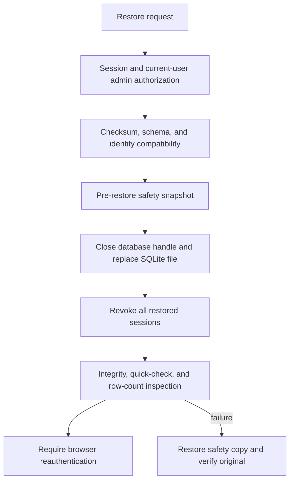

# Backup and Restore Security

This document describes the authenticated Phase 6/7 backup path for local, file-backed SQLite deployments. It is distinct from the repository's legacy shell scripts and does not claim live PostgreSQL restore support.

## Backup creation

Administrators use the canonical `/api/admin/backups` API or Backup Management page. Backup creation:

1. resolves the configured SQLite database to a canonical absolute path;
2. runs `PRAGMA wal_checkpoint(TRUNCATE)` and serializes the open database into a temporary snapshot;
3. runs `PRAGMA integrity_check` and `PRAGMA quick_check`, and verifies required operational tables;
4. encrypts the snapshot with the configured AES-256-GCM backup key;
5. calculates SHA-256 over the final encrypted artifact;
6. writes protected metadata containing timestamp, trigger, size, checksum, schema version, source basename, encryption version, algorithm, key ID, and tool version;
7. publishes the encrypted artifact and writes metadata last, so incomplete pairs are not listed; and
8. applies count-based retention after the successful publication.

The connection layer sets `PRAGMA foreign_keys = ON` and does not configure WAL. A freshly bootstrapped database therefore uses SQLite's default rollback journal; an existing database may still be in WAL mode. Backup uses the checkpoint-then-serialize path, not the separate SQLite online-backup API. That path is supported only with the single API process described below.

Backup directories use mode `0700`; backup, metadata, and audit files use `0600`. The directory must not be web-served or inside the frontend. The live SQLite database remains unencrypted.

Retention keeps the newest 10 complete backup generations (`BACKUP_RETENTION_LIMIT`) after each successful backup. The count covers every trigger (manual, scheduled, pre-restore). The newest generation and a backup selected as the restore source are never eviction candidates, so a directory can temporarily hold 11 generations while a restore source is protected; the next successful backup re-applies the limit. Incomplete artifact/metadata pairs are ignored, and a file that cannot be removed is skipped and audited. Each eviction writes a `backup_evicted` line to the operations audit; eviction failure never invalidates the newly published backup. Operators can still remove a specific backup through `DELETE /api/admin/backups/:filename`.

## Restore authorization and safeguards

Restore requires all of the following:

1. `ENABLE_DESTRUCTIVE_OPERATIONS=true`;
2. a validated `astyx_session`;
3. an active database user whose role is `admin`;
4. re-entry of the current password;
5. exact typed filename confirmation and the `RESTORE_DATABASE` phrase;
6. filename/path validation;
7. metadata, SHA-256, and expected source/active checksum validation;
8. SQLite integrity, quick-check, required-table, and schema compatibility validation;
9. compatible `users` and `sessions` tables with required columns;
10. a pre-restore safety snapshot;
11. isolated replacement with a rollback copy; and
12. post-replacement database reopen and restored-session revocation, followed by integrity/quick-check and row-count inspection.

The preflight validates `users`/`sessions` column compatibility but does not verify that the backup contains an active administrator row. Confirm an active administrator exists in the backup before restoring; otherwise the restored database can lock operators out.

Legacy plaintext backups are refused unless `ALLOW_LEGACY_PLAINTEXT_BACKUPS=true`. Recovery outside the authenticated API requires a separately reviewed offline procedure; it is not silently performed by the API.

## Recovery objectives and limitations (P4-08)

These are planning objectives for the supported single-host, single-writer SQLite
runtime. They are not contractual SLAs and do not authorize a production deployment.

| Area | Current position |
|---|---|
| Recovery point objective (RPO) | No fixed guarantee. The maximum data-loss window is the interval between successful backups. An interval schedule targets its configured interval; a daily schedule targets at most 24 hours plus execution time. The scheduler is disabled by default, so the operator owns the cadence. |
| Recovery time objective (RTO) | No fixed guarantee. It depends on database size, disk speed, key availability, and operator action. The disposable-VM release-rollback drill (backup, upgrade, rollback, restore) completed in 146 seconds end to end on synthetic data; treat that only as a drill measurement. |
| Retention | Newest 10 complete generations; the newest backup and a restore source are protected; one audit line per eviction; manual deletion remains available. |
| Backup durability | Backups are written under the configured data root on the same host. Copy encrypted backups off-host to survive host or disk loss. |
| Verification | Every created backup is integrity-checked and encrypted; API restore preflight re-verifies checksum, schema, and identity columns, but not an active administrator. Periodic restore rehearsal remains an operator responsibility. |

Limitations:

- **Single API process per data root.** Backup/restore locks and the scheduler are
  process-local module state. They do not coordinate separate processes, and the
  runtime does not detect a second process. Run exactly one API process against a
  SQLite data root; multi-worker restore is unsupported.
- **No point-in-time recovery.** There is no WAL archiving or incremental chain;
  the most recent successful backup is the recovery point.
- **No built-in off-host replication, object storage, or scheduled restore test.**
- **Key loss is unrecoverable.** Keep the active backup key and, during rotation,
  the previous keys. The backup key must differ from the cookie secret.
- **Retention is count-based, not time-based.** The scheduler's
  `keep_daily`/`keep_weekly`/`keep_monthly` fields are persisted but do not drive
  current eviction. Monitor capacity independently of backup age.
- **A protected restore source can exceed the visible limit.** The status count can
  read 11 while a restore source is protected; the next successful backup re-applies
  the limit.
- **Restore does not verify an active administrator.** It validates schema and
  identity columns but not whether the restored database contains a usable
  administrator account. Keep a reviewed recovery procedure and a known-good
  administrator path before relying on an old snapshot.
- **Some restore impact fields are placeholders.** The preflight reports
  `foreign_key_violation_count: 0`, `source_is_older: false`, and
  `possible_data_loss: false` without deriving those values. Do not treat them
  as an authoritative impact assessment.
- **The live SQLite database is not encrypted at rest.** Only backup artifacts are.
  Protect host and filesystem access.
- **Audit rotation is operator-managed.** Losing an audit file does not invalidate
  backups, but it reduces traceability.
- **Schedules and filenames use UTC.** Account for local time when defining an RPO.

## Lifecycle

An API restore is reported complete only after the restored database reopens successfully, integrity and quick checks pass, and restored sessions are revoked. The response reports the post-restore protected-table counts. Post-replacement failure enters rollback and emits a failure audit event. The prior database file is not removed until the restore is committed. If automatic rollback cannot be verified, the API responds with `RESTORE_ROLLBACK_FAILED`, leaves the surviving database and recovery files in the data root, and requires operator recovery before a retry; it does not delete the last on-disk copy. The CLI restore path reports completion after replacement; it does not perform these post-replacement checks or revoke sessions.

## Audit lifecycle

The canonical recovery-history audit is `backup_restore_audit.jsonl`. The API writes `restore_completed` and `restore_failed` with the authenticated database username, target filename, operation ID, pre-restore snapshot filename, outcome, and a controlled reason category (the error class name). The CLI writes the same event names with the OS user (`SUDO_USER` or `USER`) and records the CLI error message. The operations audit can contain a `restore_completed` line before a later failure that triggers rollback; use the canonical recovery-history outcome for the final result. Neither path currently emits `restore_requested`, `restore_denied`, `restore_started`, or `restore_rolled_back`; those remain requirements for a complete audit trail.

## Concurrency and deployment restriction

Backup and restore use process-local operation locks. Data reset uses its own process-local guard and an immediate SQLite transaction. These guards do not coordinate multiple API processes, and the runtime does not detect a second process. Run exactly one API process per SQLite data root.

The supported runtime is a single local API process. Docker/Compose and PostgreSQL are not supported runtimes; a multi-worker deployment is not a supported substitute. Do not claim multi-worker restore safety.

## Legacy scripts

`scripts/backup.sh` and `scripts/restore.sh`, where present, use the same
versioned encrypted backup envelope but remain separate operator tools. The CLI
restore path creates a pre-restore safety snapshot and writes restore audit
lines, but it does not verify the manifest, integrity, schema, or an active
administrator, and it does not revoke restored sessions or provide browser
sign-out. Use it only with all writers stopped and an approved recovery
procedure.
