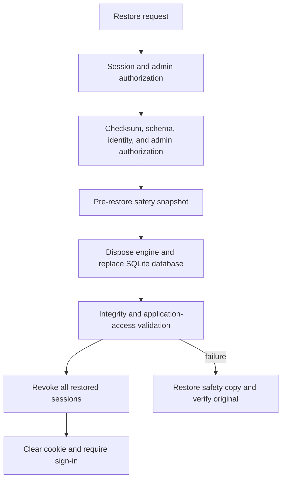

# Backup and Restore Security

This document describes the authenticated Phase 6/7 backup path for local, file-backed SQLite deployments. It is distinct from the repository's legacy shell scripts and does not claim live PostgreSQL restore support.

## Backup creation

Administrators use the canonical `/api/admin/backups` API or Backup Management page. Backup creation:

1. resolves the configured SQLite database to a canonical absolute path;
2. creates a consistent snapshot with SQLite's online backup API, including WAL state;
3. runs `PRAGMA integrity_check` and verifies required operational tables;
4. encrypts the snapshot with the configured AES-256-GCM backup key;
5. calculates SHA-256 over the final encrypted artifact;
6. writes protected metadata containing timestamp, trigger, size, checksum, schema version, source basename, encryption version, algorithm, key ID, and tool version;
7. publishes the database/metadata pair atomically; and
8. applies count-based retention.

Backup directories use mode `0700`; backup, metadata, and audit files use `0600`. The directory must not be web-served or inside the frontend. The live SQLite database remains unencrypted.

Retention keeps the newest 10 complete backup generations (`BACKUP_RETENTION_LIMIT`) after each successful backup. The count covers every trigger (manual, scheduled, pre-restore). The newest generation and a backup selected as the restore source are never eviction candidates, so a directory can temporarily hold 11 generations while a restore source is protected; the next successful backup re-applies the limit. Incomplete artifact/metadata pairs are ignored, and a file that cannot be removed is skipped and audited. Each eviction writes a `backup_evicted` line to the operations audit; eviction failure never invalidates the newly published backup. Operators can still remove a specific backup through `DELETE /api/admin/backups/:filename`.

## Restore authorization and safeguards

Restore requires all of the following:

1. `ENABLE_DESTRUCTIVE_OPERATIONS=true`;
2. a validated `astyx_session`;
3. an active database user whose role is `admin`;
4. exact typed filename confirmation;
5. filename/path validation;
6. metadata and SHA-256 validation;
7. SQLite integrity, operational-table, and schema validation;
8. compatible `users` and `sessions` tables with required columns;
9. compatible `users` and `sessions` tables with required columns (the backup is not required to contain an active administrator);
10. a pre-restore safety snapshot;
11. isolated replacement with rollback copy; and
12. post-replacement database reopen and integrity validation.

Backups created before Phase 7.1 are rejected by the authenticated runtime. Legacy recovery requires a separately reviewed offline procedure; it is not silently performed by the API.

## Recovery objectives and limitations (P4-08)

These are planning objectives for the supported single-host, single-writer SQLite
runtime. They are not contractual SLAs and do not authorize a production deployment.

| Area | Current position |
|---|---|
| Recovery point objective (RPO) | No fixed guarantee. The maximum data-loss window is the interval between successful backups. An interval schedule targets its configured interval; a daily schedule targets at most 24 hours plus execution time. The scheduler is disabled by default, so the operator owns the cadence. |
| Recovery time objective (RTO) | No fixed guarantee. It depends on database size, disk speed, key availability, and operator action. The disposable-VM release-rollback drill (backup, upgrade, rollback, restore) completed in 146 seconds end to end on synthetic data; treat that only as a drill measurement. |
| Retention | Newest 10 complete generations; the newest backup and a restore source are protected; one audit line per eviction; manual deletion remains available. |
| Backup durability | Backups are written under the configured data root on the same host. Copy encrypted backups off-host to survive host or disk loss. |
| Verification | Every created backup is integrity-checked and encrypted; restore preflight re-verifies checksum, schema, identity tables, and an active administrator. Periodic restore rehearsal remains an operator responsibility. |

Limitations:

- **Single API process per data root.** Backup/restore locks and the scheduler are
  process-local module state. They do not coordinate separate processes, and the
  runtime does not detect a second process. Run exactly one API process against a
  SQLite data root; multi-worker restore is unsupported.
- **No point-in-time recovery.** There is no WAL archiving or incremental chain;
  the most recent successful backup is the recovery point.
- **No built-in off-host replication, object storage, or scheduled restore test.**
- **Key loss is unrecoverable.** Keep the active backup key and, during rotation,
  the previous keys. The backup key must differ from the cookie secret.
- **Retention is count-based, not time-based.** The scheduler's
  `keep_daily`/`keep_weekly`/`keep_monthly` fields are persisted but do not drive
  current eviction. Monitor capacity independently of backup age.
- **A protected restore source can exceed the visible limit.** The status count can
  read 11 while a restore source is protected; the next successful backup re-applies
  the limit.
- **Restore does not verify an active administrator.** It validates schema and
  identity columns but not whether the restored database contains a usable
  administrator account. Keep a reviewed recovery procedure and a known-good
  administrator path before relying on an old snapshot.
- **The live SQLite database is not encrypted at rest.** Only backup artifacts are.
  Protect host and filesystem access.
- **Audit rotation is operator-managed.** Losing an audit file does not invalidate
  backups, but it reduces traceability.
- **Schedules and filenames use UTC.** Account for local time when defining an RPO.

## Lifecycle

A restore is reported complete only after the restored database reopens successfully, integrity and quick checks pass, and restored sessions are revoked. The response reports the post-restore protected-table counts. Post-replacement failure enters rollback and emits a failure audit event.

## Audit lifecycle

The append-only restore audit records `restore_completed` and `restore_failed` with the authenticated database username, target filename, operation ID, pre-restore snapshot filename, outcome, and a controlled reason category. Attribution comes only from the authenticated database user. Failure reasons are controlled categories rather than raw exceptions or filesystem paths.

## Concurrency and deployment restriction

Backup and restore use process-local operation locks. Data reset uses its own process-local guard and an immediate SQLite transaction. These guards do not coordinate multiple API processes, and the runtime does not detect a second process. Run exactly one API process per SQLite data root.

The supported runtime is a single local API process. Docker/Compose and PostgreSQL are not supported runtimes; a multi-worker deployment is not a supported substitute. Do not claim multi-worker restore safety.

## Legacy scripts

`scripts/backup.sh` and `scripts/restore.sh`, where present, use the same
versioned encrypted backup envelope but remain separate operator tools. They
do not replace the authenticated API chain, identity compatibility checks,
browser sign-out, or Phase 7 restore audit lifecycle.
