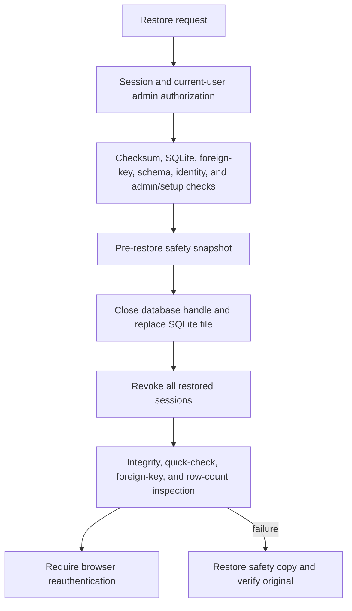

# Backup and Restore Security

This document describes the authenticated Phase 6/7 backup path for local, file-backed SQLite deployments. It is distinct from the repository's legacy shell scripts and does not claim live PostgreSQL restore support.

## Backup creation

Administrators use the canonical `/api/admin/backups` API, Backup Management page, or `backup-cli.ts backup`. Backup creation:

1. resolves the configured SQLite database to a canonical absolute path;
2. runs `PRAGMA wal_checkpoint(TRUNCATE)` and serializes the open database into a temporary snapshot;
3. runs `PRAGMA integrity_check`, `PRAGMA quick_check`, and `PRAGMA foreign_key_check`, and verifies required operational tables;
4. encrypts the snapshot with the configured AES-256-GCM backup key;
5. calculates SHA-256 over the final encrypted artifact;
6. writes protected metadata containing timestamp, trigger, size, checksum, schema version, source basename, encryption version, algorithm, key ID, and tool version;
7. publishes the encrypted artifact and writes metadata last, so incomplete pairs are not listed; and
8. applies count-based retention after the successful publication.

The connection layer sets `PRAGMA foreign_keys = ON` and does not configure WAL. A freshly bootstrapped database therefore uses SQLite's default rollback journal; an existing database may still be in WAL mode. Backup uses the checkpoint-then-serialize path, not the separate SQLite online-backup API. That path is supported only with the single API process described below.

Backup directories use mode `0700`; backup, metadata, and audit files use `0600`. The directory must not be web-served or inside the frontend. The live SQLite database remains unencrypted.

Retention keeps the newest 10 complete backup generations (`BACKUP_RETENTION_LIMIT`) after each successful API or CLI backup. The count covers manual, scheduled, and pre-restore snapshots. The newest generation and a backup selected as the restore source are never eviction candidates, so a directory can temporarily hold 11 generations while a restore source is protected; the next successful backup re-applies the limit. Incomplete artifact/metadata pairs are ignored, and a file that cannot be removed is skipped and audited. Each eviction writes a `backup_evicted` line to the operations audit; eviction failure never invalidates the newly published backup. Operators can still remove a specific backup through `DELETE /api/admin/backups/:filename`.

## Backup health status

`GET /api/admin/backups/status` checks destination accessibility and capacity,
artifact/metadata pair completeness, and the latest listed artifact's actual
file size, SHA-256, and encrypted-envelope metadata consistency. A checksum is
reported as `verified` only after reading and hashing the current artifact.
Missing, empty, truncated, mismatched, or unreadable artifacts cannot produce
`HEALTHY`. Status reads do not write history or audit events.

SQLite integrity, quick-check, and foreign-key checks performed during creation
are historical evidence. Status does not decrypt or open the backup as SQLite; it reports
`latest_backup_integrity_status: "not_checked"`. `HEALTHY` describes the checks
above, not authenticated decryption, recoverability, or a restore rehearsal.
Restore preflight still performs decryption and database validation on demand.
API and CLI creation outcomes and retention events are appended to
`backup_operations_audit.jsonl`, outside the SQLite database so restore does not
rewind that history. `GET /api/admin/backups/history` returns the latest 200
creation outcomes. Status reports the latest outcome and recorded failure details;
missing or unreadable history leaves the outcome unknown, since a manifest alone
is not an execution record. Status reads do not write history or audit events.
Older execution records without an explicit integrity result are returned with
unknown verification rather than inferred as verified.

Status verification reads and hashes the complete current encrypted artifact on
every request. A local synthetic measurement on 2026-10-22 (Bun 1.4.3, Intel
i5-3470, Linux 7.0.0-38-generic) took these median times over three repeated
checks per size; the status measurement includes file reading, hashing, envelope
parsing, and the authenticated status request:

| Plaintext size | Encrypted artifact | Read + SHA-256 | Full status request |
|---:|---:|---:|---:|
| 1 MiB | 1.33 MiB | 4.93 ms | 11.06 ms |
| 10 MiB | 13.33 MiB | 48.10 ms | 73.12 ms |
| 50 MiB | 66.67 MiB | 237.68 ms | 386.51 ms |

These are local measurements, not service thresholds or SLAs. Status verification
also holds the artifact in memory while checking its checksum and envelope;
latency and memory use grow with artifact size. Verification caching remains a
separate design decision.

Status precedence is restore in progress, backup in progress, destination
unavailable, incomplete pairs (`UNKNOWN`), no backup, failed artifact checks or
unknown capacity (`UNKNOWN`), low disk space, latest backup attempt failed, then
healthy. A missing destination
can remain available when its nearest existing ancestor is an accessible
directory where it can be created. Age is reported in seconds; status does not
apply aging/stale thresholds. Retention and restore eligibility are unchanged.

## Restore authorization and safeguards

Restore requires all of the following:

1. `ENABLE_DESTRUCTIVE_OPERATIONS=true`;
2. a validated `astyx_session`;
3. an active database user whose role is `admin`;
4. re-entry of the current password;
5. exact typed filename confirmation and the `RESTORE_DATABASE` phrase;
6. filename/path validation;
7. regular-file artifact/manifest, source identity, encrypted/plaintext size and hash, envelope metadata, and expected source/active checksum validation;
8. SQLite integrity, quick-check, foreign-key, required-table, and schema compatibility validation;
9. compatible `users` and `sessions` tables with required columns;
10. an active, unlocked administrator with an addressable username, a password hash accepted by the runtime, and a verified backup credential, or an empty database whose first-admin setup is still open;
11. a pre-restore safety snapshot;
12. isolated replacement with a rollback copy; and
13. post-replacement database reopen and restored-session revocation, followed by integrity/quick-check, foreign-key, administrator-state, and row-count inspection.

Preflight rejects a candidate without an active, currently unlocked `admin` account, an addressable username, or a password hash the runtime can parse, unless the database is empty and first-admin setup remains open. It cannot establish that an operator knows the password. Before the safety snapshot or replacement, API restore verifies either the current administrator credentials against the selected backup or the optional `candidate_admin_username` and `candidate_admin_password` supplied for one active backup administrator. It verifies that credential again after replacement; a mismatch rolls back. Credential values are excluded from logs and audit events. Open first-admin setup requires no backup credential.

CLI restore requires `--admin-user <username>` for a database with an existing administrator and prompts for that administrator's password without echo. `scripts/restore.sh` asks for the backup administrator username after confirmation and passes it to the CLI; leave the username blank only for an empty backup whose first-admin setup is still open. The CLI verifies the password before the safety snapshot and after replacement, revokes every session in the isolated candidate before replacement, and confirms no restored session remains active after replacement.

If no active backup administrator password is known, recover a controlled candidate copy before replacing the active database: use `backup-cli restore-disposable` into an empty temporary data root, run the local `admin-recovery` CLI against that candidate root for an existing active administrator, create a new encrypted backup from the repaired candidate, then copy its artifact and metadata pair into the target backup directory. Complete the normal restore using that new administrator password. During preparation, this leaves the active database and original backup intact and creates a new encrypted generation. Do not use the recovery CLI against the protected legacy `attendance.db`.
The disposable restore command validates SQLite integrity, foreign keys, and the current physical schema before reporting the candidate as restored.

Legacy plaintext backups are refused unless `ALLOW_LEGACY_PLAINTEXT_BACKUPS=true`. Password recovery is performed on an isolated candidate copy; it is never silently applied by the API.

## Recovery objectives and limitations (P4-08)

These are planning objectives for the supported single-host, single-writer SQLite
runtime. They are not contractual SLAs and do not authorize a production deployment.

| Area | Current position |
|---|---|
| Recovery point objective (RPO) | No fixed guarantee. The maximum data-loss window is the interval between successful backups. An interval schedule targets its configured interval; a daily schedule targets at most 24 hours plus execution time. The scheduler is disabled by default, so the operator owns the cadence. |
| Recovery time objective (RTO) | No fixed guarantee. It depends on database size, disk speed, key availability, and operator action. The disposable-VM release-rollback drill (backup, upgrade, rollback, restore) completed in 146 seconds end to end on synthetic data; treat that only as a drill measurement. |
| Retention | Newest 10 complete generations; the newest backup and a restore source are protected; one audit line per eviction; manual deletion remains available. |
| Backup durability | Backups are written under the configured data root on the same host. Copy encrypted backups off-host to survive host or disk loss. |
| Verification | Every created API or CLI backup is checked for SQLite integrity, quick-check, foreign-key violations, required schema, and encryption; API restore preflight verifies checksum, integrity, quick-check, foreign keys, schema, identity columns, and an active, unlocked administrator with a runtime-parseable password hash or open first-admin setup. API restore verifies one backup administrator password before and after replacement. CLI restore verifies encrypted artifact identity/checksum/authentication, SQLite integrity, quick-check, foreign keys, schema, administrator/setup eligibility, and an unlocked administrator credential before and after replacement. Periodic restore rehearsal remains an operator responsibility. |

Limitations:

- **Single API process per data root.** Backup/restore locks and the scheduler are
  process-local module state. They do not coordinate separate processes, and the
  runtime does not detect a second process. Run exactly one API process against a
  SQLite data root; multi-worker restore is unsupported.
- **No point-in-time recovery.** There is no WAL archiving or incremental chain;
  the most recent successful backup is the recovery point.
- **No built-in off-host replication, object storage, or scheduled restore test.**
- **Key loss is unrecoverable.** Keep the active backup key and, during rotation,
  the previous keys. The backup key must differ from the cookie secret.
- **Retention is count-based, not time-based.** The scheduler's
  `keep_daily`/`keep_weekly`/`keep_monthly` fields are persisted but do not drive
  current eviction. Monitor capacity independently of backup age.
- **A protected restore source can exceed the visible limit.** The status count can
  read 11 while a restore source is protected; the next successful backup re-applies
  the limit.
- **Preflight cannot verify operator knowledge of credentials.** It verifies
  that an active unlocked administrator's hash is parseable by the runtime. API and CLI
  restore then require a password that matches an active, unlocked administrator in the
  selected backup. Use the isolated-candidate recovery procedure above when the
  backup password is unknown.
- **Some restore impact facts cannot be derived.** Preflight reports
  `source_is_older: null` because the active database has no authoritative
  content timestamp. `possible_data_loss` is `false` only when source and active
  database checksums match; otherwise it is `null` because table counts do not
  prove whether records were lost or replaced. The UI displays unknown values
  explicitly and warns that preflight is not a row-level difference report.
Counts for a missing or unreadable table and their deltas are also `null`; the
preview displays them as unknown and marks a backup with failed physical-schema,
integrity, quick-check, or foreign-key validation as ineligible before restore.
- **The live SQLite database is not encrypted at rest.** Only backup artifacts are.
  Protect host and filesystem access.
- **Audit rotation is operator-managed.** Losing an audit file does not invalidate
  backups, but it reduces traceability.
- **Schedules and filenames use UTC.** Account for local time when defining an RPO.

## Lifecycle

An API restore is reported complete only after the restored database reopens successfully, integrity and quick checks pass, no foreign-key violations are found, administrator/setup eligibility remains valid, the selected backup's administrator credential still verifies, and restored sessions are revoked. Preflight reports the actual foreign-key violation count; an unavailable check or any violation blocks restore. The response reports the measured post-restore foreign-key count and protected-table counts. Post-replacement failure enters rollback and emits a terminal audit event. The prior database file is not removed until the restore is committed. A failure before replacement reports `RESTORE_NOT_APPLIED`; unavailable operations-audit storage reports `RESTORE_AUDIT_UNAVAILABLE` with status 503. `RESTORE_ROLLED_BACK` is returned only after the prior database is restored and verified. If automatic rollback cannot be verified, the API responds with `RESTORE_ROLLBACK_FAILED`, leaves the surviving database and recovery files in the data root, and requires operator recovery before a retry; it does not delete the last on-disk copy.

The `backup-cli.ts restore` path verifies an encrypted artifact's manifest filename, source basename, format version, algorithm, key ID, encrypted SHA-256, plaintext SHA-256, and AES-256-GCM authentication. It validates SQLite integrity, quick-check, foreign keys, required tables, current schema, and administrator/setup eligibility before replacement and again after replacement. An active administrator must have `role='admin'`, `is_active=1`, an addressable username no longer than 255 characters, an unlocked account, and a password hash accepted by the runtime. The operator must also provide the matching username with `--admin-user` and its password through the hidden prompt. A database with no users remains eligible only while first-admin setup is incomplete. When an active database exists, the CLI validates the candidate credential before it creates the encrypted safety snapshot and uses the shared rollback transaction; post-replacement failure triggers rollback. Every session in the candidate is revoked before replacement and verified again after replacement; the source artifact remains unchanged. If rollback cannot be verified, the CLI preserves remaining recovery files and refuses another restore while a rollback file remains. A hard process or host interruption can leave the original database at that rollback path for operator recovery. Explicitly opted-in legacy plaintext receives the SQLite and credential checks but has no encrypted manifest, checksum, or authenticated-decryption evidence. Once a backup root is configured, the CLI attempts terminal restore audit records for path, artifact, manifest, decryption, candidate-validation, and swap failures; it writes a sanitized filename (or `unknown`) and a controlled reason category, with one operation ID shared across the operations and recovery-history logs. Audit writes are independent and best-effort; a missing backup root or unavailable audit storage can still prevent a record, and a failed post-commit audit does not undo the committed restore. Use the CLI only with all writers stopped and an approved recovery procedure.

## Audit lifecycle

The canonical recovery-history audit is `backup_restore_audit.jsonl`. After administrator authorization, the API attempts to record `restore_requested`, then `restore_denied` for a refusal before replacement or `restore_started` immediately before replacement. A terminal event is `restore_completed`, `restore_rolled_back` only after verified rollback, or `restore_failed` when recovery is not confirmed. The CLI attempts the same lifecycle once its backup root is known. Records include one operation ID per attempt, target filename, actor, optional safety-snapshot filename, and a controlled reason code or error class; raw error messages, credentials, and paths are not recorded. Unauthenticated and unauthorized HTTP requests are not written to this file. Lifecycle appends are best-effort, so missing or unwritable audit storage can leave gaps.

Before API replacement, the operations-audit path must be writable; if it is unavailable, restore stops before swapping databases and reports `RESTORE_AUDIT_UNAVAILABLE`. The canonical API completion record is the last fallible step inside the rollback-protected swap; if it cannot be written, the transaction rolls back. The operations-audit `restore_completed` line is written only after the swap commits, so a rolled-back attempt cannot claim completion there. That operations entry is best-effort after commit. CLI canonical and operations audit writes are best-effort after commit and do not undo a completed restore.

## Concurrency and deployment restriction

Backup and restore use process-local operation locks. Data reset uses its own process-local guard and an immediate SQLite transaction. These guards do not coordinate multiple API processes, and the runtime does not detect a second process. Run exactly one API process per SQLite data root.

The supported runtime is a single local API process. Docker/Compose and PostgreSQL are not supported runtimes; a multi-worker deployment is not a supported substitute. Do not claim multi-worker restore safety.

## Legacy scripts

`scripts/backup.sh` and `scripts/restore.sh`, where present, use the same
versioned encrypted backup envelope but remain separate operator tools. The CLI
restore path described above validates encrypted artifact identity, checksum,
authenticated decryption, SQLite state, and administrator/setup eligibility
before and after replacement. It creates a safety snapshot when an active
database exists, revokes restored sessions, and attempts rollback on failure.
Explicitly opted-in legacy plaintext lacks encrypted artifact verification.
Use the CLI only with all writers stopped and an approved recovery procedure.
